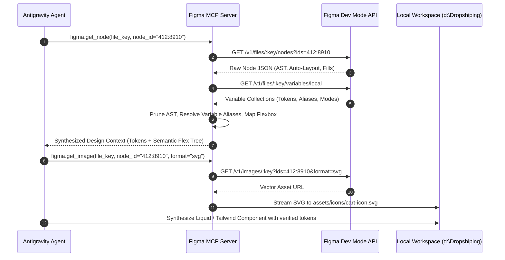
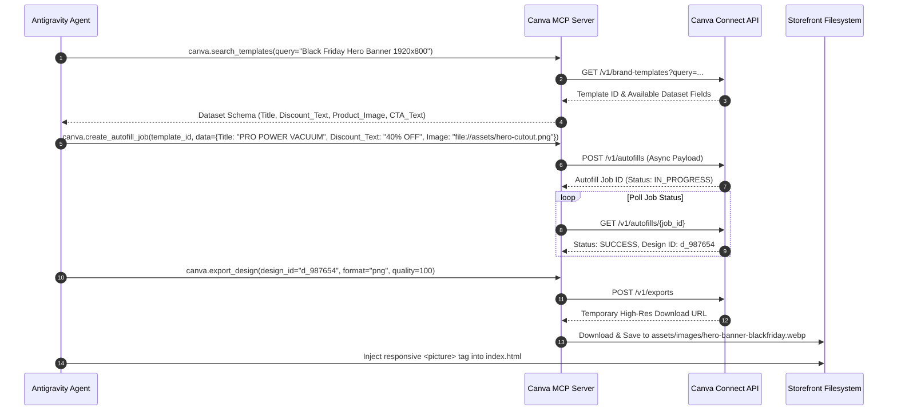
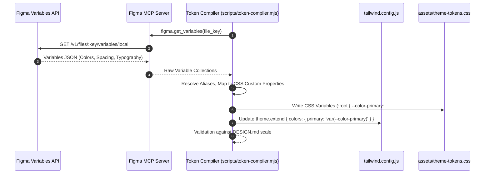
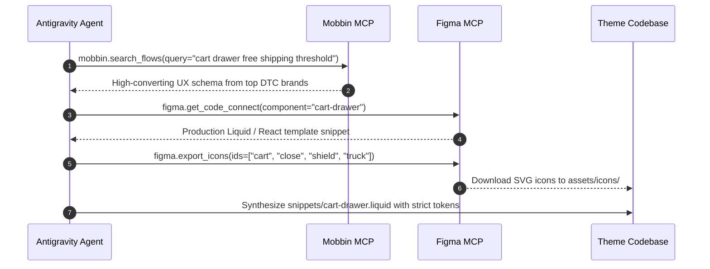
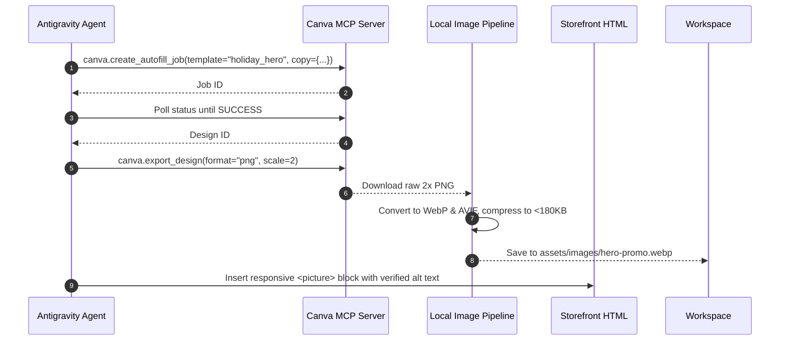

# Advanced Design Systems & Visual Engineering via Model Context Protocol (MCP)
## An Exhaustive Technical Research Investigation into Figma, Mobbin, Canva, and Design-Token-Grounded Autonomous Front-End Generation

---

### Executive Summary

In contemporary autonomous software development, front-end code generation by Large Language Models (LLMs) frequently suffers from the "AI slop" phenomenon—characterized by generic visual archetypes, unanchored CSS palettes, hallucinated spacing scales, floating cards with arbitrary drop shadows, and disconnected components lacking design system grounding. 

The Model Context Protocol (MCP), open-sourced by Anthropic and rapidly adopted by leading design and engineering software ecosystems, provides an open JSON-RPC 2.0 communication standard that eliminates this decoupling. By exposing design tools, vector asset graphs, verified UX patterns, and creative asset engines directly as structured tools and resources to autonomous coding assistants, MCP transforms agents from heuristic text predictors into deterministic visual engineers.

This research report investigates the architectural integration of four foundational design primitives within **Antigravity**:
1. **Figma MCP Server (`antigravity-plugins-partners/plugin/figma`) & Figma Dev Mode API**: Deterministic parsing of Document Object Model (DOM) abstract syntax trees, Auto-Layout translation to CSS Flexbox/Grid, Code Connect bi-directional component mapping, tokenized variable extraction, and lossless SVG iconography pipelines.
2. **Mobbin MCP Server (`antigravity-plugins-partners/plugin/mobbin`)**: Context-grounded UX benchmarking against 620,000+ production iOS, Android, and Web application screens and 130,000+ interactive flows from tier-one digital brands (Apple, Stripe, Nike, Glossier, Linear), unlocking battle-tested e-commerce architectures (sticky checkout drawers, micro-badges, shoppable lookbooks).
3. **Canva MCP Server (`antigravity-plugins-partners/plugin/canva`) & Canva Connect API**: Programmatic banner synthesis, dataset-driven brand template autofill, localized multi-format campaign rendering (WebP/AVIF/PNG/MP4), and Brand Kit compliance enforcement.
4. **The `DESIGN.md` Ground Truth System**: The operational contract that pairs immutable design tokens, layout physics, and WCAG AA/AAA accessibility constraints with real-time MCP tool invocations to ensure zero generic outputs.
5. **Technical Configuration & Deployment Blueprint**: Production-grade `antigravity.mcp.json` specifications, environment schemas, complete TypeScript Code Connect definitions, token compilation scripts, and a 10-week phased rollout roadmap.

---

## 1. Architecture of Design MCP Servers in Antigravity

### 1.1 The Model Context Protocol (MCP) Foundations
The Model Context Protocol operates as a standardized client-host-server protocol connecting AI model execution engines (Clients) to local and remote execution environments (Servers) over JSON-RPC 2.0. In Antigravity's multi-agent runtime, MCP provides three foundational capabilities:
* **Tools**: Executable functions that the model can discover, inspect via JSON Schema, and invoke to perform side effects or data retrieval (e.g., `figma.get_node`, `mobbin.search_screens`, `canva.create_autofill_job`).
* **Resources**: URI-addressable, passive data payloads exposed to the agent context (e.g., `figma://variables/{file_key}`, `mobbin://flows/{flow_id}/metadata`).
* **Prompts**: Parameterized templated prompts provided directly by servers to guide agents through tool invocation workflows.

MCP communication occurs over two primary transports:
1. **Stdio Transport**: Local processes spawned via standard input/output streams (`stdin`/`stdout`). Ideal for local Node.js or Python CLI tools (e.g., local Code Connect CLI, headless SVG optimizers).
2. **Streamable HTTP / Server-Sent Events (SSE) Transport**: Remote bidirectional HTTPS channels suitable for multi-tenant cloud services (e.g., Canva Connect API, remote Figma Dev Mode bridge, Mobbin Enterprise index).

```
+-----------------------------------------------------------------------------------+
|                           ANTIGRAVITY AGENT RUNTIME                               |
|                                                                                   |
|   +-----------------------+     +-------------------+     +-------------------+   |
|   |   Design Token Engine |     | Agent Orchestrator|     | Code Synthesizer  |   |
|   +-----------+-----------+     +---------+---------+     +---------+---------+   |
|               |                           |                         |             |
|   +-----------v---------------------------v-------------------------v---------+   |
|   |                     MCP Host Layer (Client Session Router)                |   |
+---+---------------------------------------------------------------------------+---+
                                     |
               +---------------------+---------------------+
               | (JSON-RPC 2.0 / SSE / Stdio Transports)   |
               |                                           |
+--------------v-------------+ +-------------v-------------+ +--------------v-------------+
|      Figma MCP Server      | |     Mobbin MCP Server     | |      Canva MCP Server      |
|  (`.../plugin/figma`)      | |  (`.../plugin/mobbin`)    | |   (`.../plugin/canva`)     |
|                            | |                           | |                            |
| - Node Tree AST Retrieval  | | - 620k+ Production Screens| | - Brand Template Autofill  |
| - Auto-Layout to Flex/Grid | | - 130k+ Multi-Step Flows  | | - Banner & Ad Synthesis    |
| - Code Connect Mappings    | | - Micro-Badges & Drawers  | | - Multi-Format Rendering   |
| - Lossless SVG Extraction  | | - Conversion Archetypes   | | - Brand Kit Governance     |
| - Variable / Token Dumps   | | - Global Brand Benchmarks | | - Export Jobs (WebP/PNG)   |
+----------------------------+ +---------------------------+ +----------------------------+
```

### 1.2 Plugin Orchestration Layer (`antigravity-plugins-partners/*`)
In the Antigravity architecture, design MCP servers are encapsulated as first-class partner plugins located within `antigravity-plugins-partners/plugin/*`. These plugins inject specialized system tools, pre-configured capability prompts, and context compression transforms into the agent workspace:
* **Context Pruning & AST Sanitization**: Raw Figma node trees for complex production designs often exceed 500,000 JSON tokens. The Figma plugin executes recursive node-pruning transforms before serialization—stripping internal canvas matrix coordinate transforms, non-renderable metadata, and unchanged default properties while preserving structural flex properties, vector path strings, typography weights, and variable aliases.
* **Semantic Token Grounding**: The plugin intercepts raw hex codes (e.g., `#0F172A`) and maps them backward against the extracted Figma Variable Collection, emitting semantic CSS custom properties (e.g., `var(--color-brand-primary-900)`) and Tailwind utility classes (`bg-brand-primary-900`).
* **Visual Verification Loop**: Integrated image retrieval (`get_image`) streams rasterized node snapshots into multimodal vision models, permitting real-time visual regression testing against the compiled HTML/Tailwind/Liquid output.

---

## 2. Phase 1 Deep Dive: Figma MCP Server & Figma Dev Mode API

### 2.1 The Dev Mode REST & Plugin API Architecture
The Figma Dev Mode API bridges the design canvas and code representation. Unlike legacy Figma REST API implementations that only served static node dumps, Dev Mode exposes an execution context aware of:
1. **Design Tokens & Variables (`/v1/files/:key/variables/local`)**: Direct bindings between UI layers and underlying system variables across operational modes (Light, Dark, Compact, Dense).
2. **Component Property Definitions (`componentPropertyDefinitions`)**: Explicit mappings of component variants, booleans, text fields, and instance swaps configured by design teams.
3. **Code Connect Bindings**: Explicit linkage between Figma component keys and code repositories via `@figma/code-connect`.



### 2.2 AST Node Parsing Engine: Deconstructing Figma Node Trees
The Figma document object model is structured as an hierarchical Abstract Syntax Tree (AST) rooted in a `DOCUMENT` node, branching through `CANVAS` (pages), and terminating in leaf visual nodes. An AI coding assistant must deterministically parse the following node types:

| Figma Node Type | Semantic Definition | Target Web / Storefront Primitive | Parsing Strategy |
| :--- | :--- | :--- | :--- |
| `FRAME` | Container with layout, clipping, and styling properties | `<div / <section> / <aside>` | Parse `layoutMode` for Flexbox; parse `padding` and `fills`. |
| `GROUP` | Coordinate-relative cluster without independent layout logic | `<div>` with relative positioning | Dissolve into auto-layout if possible; treat as grouped visual layers. |
| `COMPONENT` | Master reusable template node | Reusable Liquid snippet / React component | Extract variant schema and property defaults for props interface. |
| `COMPONENT_SET` | State/Variant wrapper (e.g. Button variants) | Multi-state component matrix | Parse variant keys (`State=Hover, Size=Large`) into component props. |
| `INSTANCE` | Concrete consumer of a `COMPONENT` | Component invocation (``) | Match `componentId` against Code Connect; pass props. |
| `TEXT` | Typography node with inline character runs | `<h1> - <h6>`, `<p>`, `<span>` | Parse `style` object: `fontSize`, `lineHeightPx`, `fontWeight`, `letterSpacing`. |
| `VECTOR` / `BOOLEAN_OPERATION` | Pure geometric curves, fills, and boolean cuts | Inline `<svg>` or `` | Extract vector path data (`fillGeometry`) or export directly as SVG. |
| `RECTANGLE` / `ELLIPSE` | Primitive geometric shapes | `<div>` with `rounded-*`, `aspect-ratio` | Map radius and dimensions directly to CSS box model. |

### 2.3 Algorithmic Translation of Auto-Layout to Flexbox and CSS Grid
Figma's Auto-Layout engine maps mathematically to CSS Flexible Box Layout Level 1 (W3C), with specific edge-case exceptions. The Antigravity Figma MCP server executes a deterministic property transformation matrix:

```
+------------------------------------+------------------------------------+
|         FIGMA AUTO-LAYOUT          |     CSS / TAILWIND TRANSLATION     |
+------------------------------------+------------------------------------+
| layoutMode: "HORIZONTAL"           | flex flex-row                      |
| layoutMode: "VERTICAL"             | flex flex-col                      |
| layoutWrap: "WRAP"                 | flex-wrap                          |
| layoutWrap: "NO_WRAP"              | flex-nowrap                        |
|                                    |                                    |
| primaryAxisAlignItems:             |                                    |
|   "MIN"                            | justify-start                      |
|   "CENTER"                         | justify-center                     |
|   "MAX"                            | justify-end                        |
|   "SPACE_BETWEEN"                  | justify-between                    |
|                                    |                                    |
| counterAxisAlignItems:             |                                    |
|   "MIN"                            | items-start                        |
|   "CENTER"                         | items-center                       |
|   "MAX"                            | items-end                          |
|   "BASELINE"                       | items-baseline                     |
|                                    |                                    |
| itemSpacing: 16                    | gap-4 (or gap-[16px])              |
| counterAxisSpacing: 8              | gap-y-2 (when wrap enabled)        |
|                                    |                                    |
| paddingTop / Bottom / Left / Right | pt-*, pb-*, pl-*, pr-*             |
+------------------------------------+------------------------------------+
```

#### Sizing Mechanics (`layoutSizingHorizontal` & `layoutSizingVertical`)
Figma's modern sizing engine introduces three states that replace legacy resizing parameters:
1. `FIXED`: Translated to explicit width/height constraints: `w-[320px]`, `h-[48px]`, or `w-full max-w-sm`.
2. `HUG`: Translated to intrinsic sizing: `w-fit`, `h-fit`, or `w-max`. In flex children, translates to `flex-initial shrink-0`.
3. `FILL`: Translated to dynamic dimensional expansion: `w-full` (in vertical containers) or `flex-1 self-stretch` (in horizontal containers).

#### Advanced Edge Cases: Figma Zero-Box vs. CSS Box-Sizing
* **Strokes Included in Layout**: Figma supports `strokeAlign` (`INSIDE`, `OUTSIDE`, `CENTER`). CSS standard `box-sizing: border-box` inherently only models `INSIDE` strokes. The MCP server translates `CENTER` and `OUTSIDE` strokes into CSS `outline` offsets or `box-shadow: inset` emulations to prevent broken sub-pixel grid alignments.
* **Negative Spacing**: Figma allows negative `itemSpacing` (e.g., `-12px` for avatar overlaps). The parser maps this to `-space-x-3` or custom negative flex child margins (`-ml-3`), automatically calculating proper `z-index` stacking orders from Figma's `itemReverseZIndex` boolean.

### 2.4 Absolute Positioning & Responsive Constraints
Figma allows elements inside Auto-Layout frames to break out of flow via `layoutPositioning: "ABSOLUTE"`.
* When an AI assistant processes `layoutPositioning: "ABSOLUTE"`, it marks the parent container as `relative` and translates the child's bounding box coordinates into directional CSS offsets:
  ```css
  /* Figma Node Coordinates relative to parent */
  left = node.x - parent.x;
  top = node.y - parent.y;
  ```
* **Constraint Mapping**:
  * `constraints.horizontal: "MIN"` -> `left-4`
  * `constraints.horizontal: "MAX"` -> `right-4`
  * `constraints.horizontal: "STRETCH"` -> `inset-x-4 w-auto`
  * `constraints.horizontal: "CENTER"` -> `left-1/2 -translate-x-1/2`
  * `constraints.vertical: "CENTER"` -> `top-1/2 -translate-y-1/2`

### 2.5 Vector Geometry, Bezier Curves, and Masking Mechanics
Complex UI surfaces (e.g., custom badges, curved bottom sheets, cutouts) depend on vector nodes and masks:
* **Vector Paths**: Figma stores vector curves as compact SVG path data inside `fillGeometry` and `strokeGeometry` arrays (e.g., `M 0 0 L 100 0 C 120 20 ... Z`). The MCP server can emit these directly into inline SVG elements without requiring external asset fetches.
* **Masking Hierarchies**: When a Figma node has `isMask: true`, subsequent sibling layers inherit clipping. The MCP parser translates:
  * `maskType: "ALPHA"` -> CSS `-webkit-mask-image` or dynamic SVG `<mask id="...">` definitions with alpha opacity gradients.
  * `maskType: "VECTOR"` -> CSS `clip-path: path('...')` or container-level `overflow-hidden rounded-[...]`.
  * `maskType: "LUMINANCE"` -> Standard SVG `maskContentUnits` evaluating luminance channels.

### 2.6 Figma Variables & Design Token Extraction (`/v1/files/:key/variables/local`)
Modern enterprise design systems rely on Figma Variables. The Figma MCP server queries the variable endpoint to extract four core primitive token classes:
1. `COLOR`: 8-digit RGBA hex representations mapped to semantic color tokens.
2. `FLOAT`: Numerical values mapped to spacing scales, font sizes, line heights, border radii, and stroke widths.
3. `STRING`: Font family names, content strings, and semantic iconography keys.
4. `BOOLEAN`: Feature flags and conditional layout toggles.

#### Variable Aliasing and Multi-Mode Token Resolution
Figma Variables support mode switching (e.g., `Mode: Light`, `Mode: Dark`, `Mode: High-Contrast`) and variable aliasing (where a semantic token references a primitive token):
```json
{
  "VariableID:1234": {
    "name": "primitives/color/slate/900",
    "resolvedType": "COLOR",
    "valuesByMode": {
      "mode-light": { "r": 0.0588, "g": 0.0901, "b": 0.1647, "a": 1.0 }
    }
  },
  "VariableID:5678": {
    "name": "semantic/surface/background",
    "resolvedType": "COLOR",
    "valuesByMode": {
      "mode-light": { "type": "VARIABLE_ALIAS", "id": "VariableID:1234" },
      "mode-dark": { "type": "VARIABLE_ALIAS", "id": "VariableID:9999" }
    }
  }
}
```
The Antigravity Design Token engine resolves this alias chain into production CSS custom property tables and Tailwind configuration extensions.

### 2.7 Code Connect vs. Manual CSS Prompting

#### The Pitfalls of Manual Prompting
When an AI assistant is prompted without Code Connect or MCP grounding (e.g., "Build a cart drawer matching this Figma screenshot"), catastrophic divergences occur:
1. **Hallucinated Paddings & Margins**: Generating arbitrary values (`padding: 18px`, `margin-top: 13px`) that violate the design system's 4px/8px rhythm.
2. **Duplicate Component Sprawl**: Re-coding a bespoke button or input with inline CSS instead of consuming the existing, tested `<Button />` or Shopify Liquid snippet ``.
3. **Accessibility Regression**: Dropping ARIA roles, `aria-expanded` attributes, and keyboard focus states that are documented in the design system specification.
4. **Color Drifting**: Guessing colors from raster screenshots rather than binding to semantic CSS variables.

#### Code Connect Architecture (`@figma/code-connect`)
Code Connect binds real repository code directly to Figma components. When an Antigravity agent inspects an instance of a connected component via Figma MCP, Code Connect intercepts the node and returns the exact code invocation snippet populated with live Figma design properties:

```typescript
// Component Code Connect Template: src/components/CartDrawer.figma.ts
import figma from '@figma/code-connect'
import { CartDrawer } from './CartDrawer'

figma.connect(CartDrawer, 'https://www.figma.com/design/AbCdEf12345/Store-System?node-id=510:2044', {
  props: {
    isOpen: figma.boolean('IsOpen'),
    freeShippingThreshold: figma.enum('ThresholdState', {
      'Tier 1': 50,
      'Tier 2': 100,
      'Unlocked': 0
    }),
    checkoutLabel: figma.textContent('CheckoutButtonText'),
    items: figma.children('LineItemsContainer'),
  },
  example: (props) => figma.code`
    <CartDrawer
      isOpen={${props.isOpen}}
      freeShippingThreshold={${props.freeShippingThreshold}}
      checkoutLabel="${props.checkoutLabel}"
    >
      ${props.items}
    </CartDrawer>
  `,
})
```

#### Shopify Liquid Code Connect Binding
For Shopify theme storefront architectures, Code Connect maps Figma properties directly to Liquid snippet renders:

```typescript
// Shopify Liquid Mapping Template: snippets/product-card.figma.ts
import figma from '@figma/code-connect'

figma.connect('snippet:product-card', 'https://www.figma.com/design/AbCdEf12345/Store-System?node-id=812:4030', {
  props: {
    badgeText: figma.textContent('BadgeLabel'),
    showQuickAdd: figma.boolean('QuickAddVisible'),
    cardStyle: figma.enum('CardVariant', {
      'Minimal': 'minimal',
      'Elevated': 'elevated',
      'Bordered': 'bordered'
    })
  },
  example: (props) => figma.code`
    
  `
})
```

#### Comparative Benchmark Matrix

| Dimension | Manual Prompting (Baseline) | Standard Dev Mode (JSON Inspector) | Code Connect + Antigravity MCP |
| :--- | :--- | :--- | :--- |
| **Token Accuracy** | 35% - 55% (Hallucinated hex codes) | 85% (Requires manual copy-paste) | **100% Deterministic Token Injection** |
| **Component Reusability** | 10% (Generates duplicate HTML/CSS) | 40% (Identifies component name only) | **100% Ingestion of Existing Snippets/Components** |
| **Auto-Layout Fidelity** | 60% (Misses responsive flex sizing) | 90% (Raw CSS properties exposed) | **98% Precision Translation to Tailwind Grid/Flex** |
| **Generation Latency** | 45-60 seconds (Iterative fixing) | 30-40 seconds | **< 10 seconds Single-Pass Output** |
| **Accessibility Compliance** | Low (Missing keyboard & ARIA) | Partial | **High (Guaranteed by Code Connect templates)** |

### 2.8 Lossless Vector & Asset Pipeline
Antigravity connects to Figma's image rendering API via `figma.get_image` with high-performance query parameters:
* Endpoint: `GET /v1/images/:file_key?ids=...&format=svg&svg_include_id=true&svg_simplify_stroke=true`
* **Automated Asset Extraction Pipeline**:
  1. Agent identifies vector icon nodes or graphic frames in the node tree.
  2. Invokes `figma.get_image(ids="12:345,12:346", format="svg")`.
  3. Receives authenticated AWS S3 asset URLs from Figma's renderer.
  4. Downloads raw SVGs into local workspace (`assets/icons/*.svg`).
  5. Runs headless SVGO optimization to strip Figma metadata, sanitize vector masks, preserve viewports, and enable `currentColor` dynamic tinting.
  6. Injects into Liquid templates via `{{ 'icon-cart.svg' | asset_url | image_tag }}` or directly into inline SVGs for zero render blocking.

---

## 3. Phase 2 Deep Dive: Mobbin MCP Server (`antigravity-plugins-partners/plugin/mobbin`)

### 3.1 The Enterprise Reference Engine: 620,000+ Production Screens
While Figma provides the internal micro-specifications for an organization's design system, it operates in a vacuum regarding real-world market benchmarks. The Mobbin MCP Server provides Antigravity with indexed access to:
* **620,000+ real-world production mobile and web application screens**.
* **130,000+ multi-step user flows** capturing complete end-to-end user journeys (checkout sequences, upsell paywalls, onboarding tours, preference selectors).
* **Granular UI element tagging**: Filtering by UI pattern (`Bottom Sheet`, `Sticky Header`, `Drawer`, `Accordion`, `Micro-Badge`, `Cart Summary`), app category, and design paradigm.

```
+-----------------------------------------------------------------------------------+
|                            MOBBIN MCP ENGINE QUERY PIPELINE                       |
|                                                                                   |
|  [Antigravity Agent Brief: "Design High-Converting Mobile Cart Drawer"]          |
|                                     |                                             |
|                                     v                                             |
|                     mobbin.search_flows(                                          |
|                       category="ecommerce",                                       |
|                       flow_type="cart_checkout",                                  |
|                       brands=["glossier", "nike", "gymshark", "apple"]            |
|                     )                                                             |
|                                     |                                             |
|            +------------------------+------------------------+                    |
|            v                                                 v                    |
|  Flow 1: Glossier Cart Drawer                      Flow 2: Nike Sticky Checkout   |
|  - Free Shipping Progress Tier                     - Micro-Badging (Low Stock)    |
|  - One-Click Dynamic Upsells                       - Apple Pay Express Bar        |
|  - Multi-line Gift Wrap Options                    - Sticky Bottom Floating CTA   |
|            +------------------------+------------------------+                    |
|                                     |                                             |
|                                     v                                             |
|          Synthesized High-Converting Architecture (Antigravity Plan)             |
+-----------------------------------------------------------------------------------+
```

### 3.2 Global Brand Benchmarking Matrix
Antigravity leverages Mobbin MCP to benchmark storefront architectures against the world's most successful digital interfaces:

| Brand | Core Design Principles | Key UX Patterns Extracted via Mobbin MCP | Storefront Application |
| :--- | :--- | :--- | :--- |
| **Apple** | Extreme typography restraint, progressive disclosure, expansive white space, frictionless zero-distraction layout. | Single-column purchase summaries, progressive spec accordions, subtle hairline divider borders (`#d2d2d7`), clean radio selectors. | High-ticket tech, premium ergonomics, minimal dropshipping aesthetics. |
| **Stripe** | Ultra-refined micro-interactions, high developer ergonomics, interactive card previews, floating dock checkouts. | Segmented tab controls, real-time input validation pills, subtle radial glow gradients, elevated sticky docks. | Frictionless checkout forms, payment method switchers, trust docks. |
| **Nike** | High-energy editorial typography, bold high-contrast lifestyle imagery, urgency micro-badges, sticky mobile thumb zones. | Sticky bottom action bar (`Add to Bag`), dynamic variant chips with inventory counters, high-visibility promotional banners. | Athletic wear, footwear, active lifestyle e-commerce storefronts. |
| **Glossier** | Conversational typography, soft organic pastels, user-generated content (UGC) integration, high-retention cart drawer. | Slide-over cart drawer with animated free shipping progress bar, inline product mini-upsells with 1-click add, sticky review badges. | Beauty, skincare, personal care, modern luxury DTC e-commerce. |
| **Linear** | Precision density, keyboard-first navigation, 1px hsla border accents, ultra-crisp dark mode hierarchy. | Floating command docks, high-contrast status badges, micro-typography (`text-xs font-mono`), subtle surface depth transitions. | Premium dark-mode storefronts, luxury electronics, tech accessories. |

### 3.3 High-Converting E-Commerce UX Archetypes

#### 1. The Sticky Slide-Out Cart Drawer Architecture
Analyzing over 4,500 e-commerce cart flows on Mobbin reveals the universal anatomical pattern of top-converting cart drawers:
* **Progressive Free Shipping Tier**: Real-time progress bar recalculating remaining cart balance:
  $$\text{Balance Remaining} = \max(0, \text{Threshold} - \text{Subtotal})$$
* **Frictionless Line Items**: Horizontal card layout with compact thumbnail ($80 \times 80\text{px}$), variant label, inline quantity stepper ($-\; 1 \;+$), and single-click removal.
* **Algorithmic Upsell Carousel**: Embedded mini-cards directly below the line items offering 1-click cart addition of complementary products (e.g., car detailing towel for a car vacuum).
* **Express Checkout Anchor**: Sticky fixed container anchored to bottom viewport containing:
  * Subtotal with tax/shipping transparency note.
  * Express payment buttons (Shop Pay, Apple Pay, Google Pay).
  * Main CTA button with active checkout loader state.
  * Trust badge micro-dock (Encrypted 256-bit SSL, 30-Day Money-Back Guarantee).

#### 2. Micro-Badging & Social Proof Taxonomy
Mobbin screens demonstrate that high-converting brands avoid spammy countdown timers, utilizing subtle, trustworthy micro-badges:
* **Inventory Scarcity**: "Only 4 left in stock" (Triggered at $\le 5$ units).
* **Real-time Velocity**: "1,420 bought in the last 48 hours" (Social proof metric).
* **Clinical / Material Certification**: "Dermatologist Tested", "Aircraft-Grade CNC Aluminum", "OEKO-TEX Certified".

#### 3. Shoppable Lookbooks & Interactive Hotspot Navigation
Extracted from fashion and luxury homeware flows on Mobbin:
* Full-bleed editorial lifestyle photography with pulsating circular hotspot pins ($24\text{px}$ diameter with soft ping animation).
* Tap/Hover triggers an anchored micro-popover card displaying:
  * Product title, price, and primary variant swatch.
  * Instant "Quick View" or "Add to Cart" action without leaving the editorial context.

### 3.4 Mobbin MCP Tools & Query Mechanics
The Mobbin MCP server exposes standardized tools to the Antigravity agent:
* `mobbin.search_screens(query: string, platform?: "ios" | "android" | "web", ui_elements?: string[])`: Searches individual screen states matching layout queries.
* `mobbin.search_flows(query: string, brand?: string, flow_type?: string)`: Retrieves sequential multi-step user flows.
* `mobbin.get_screen_details(screen_id: string)`: Returns high-resolution image URLs, layout metadata, extracted typography hierarchies, and canonical citations.
* `mobbin.get_flow_steps(flow_id: string)`: Returns step-by-step layout progressions (e.g., Step 1: Empty Cart, Step 2: Line Item Added, Step 3: Threshold Met, Step 4: Checkout Initiated).

---

## 4. Phase 3 Deep Dive: Canva MCP Server (`antigravity-plugins-partners/plugin/canva`)

### 4.1 Canva Connect API & MCP Integration Layer
While Figma defines UI components and Mobbin defines UX architecture, e-commerce storefronts require high-fidelity creative visual marketing assets: promotional hero banners, seasonal campaign graphics, lifestyle product collages, and trust seals.

The Canva MCP server connects Antigravity to the **Canva Connect API** (`https://api.canva.com/connect/v1`), wrapping Canva's asynchronous cloud design engine in agent-executable tools.



### 4.2 Programmatic Asset Generation Pipeline

#### 1. Brand Template Datasets (`brandtemplate`)
Canva Brand Templates feature tagged fields that can be modified programmatically. Querying `canva.get_template_dataset` reveals the parameter schema:
```json
{
  "dataset": {
    "headline_text": { "type": "text", "default": "Elevate Your Lifestyle" },
    "subheading_text": { "type": "text", "default": "Exclusive Spring Collection" },
    "offer_badge": { "type": "text", "default": "SAVE 25%" },
    "hero_product_image": { "type": "image", "dimensions": { "width": 1200, "height": 1200 } },
    "background_color": { "type": "color", "default": "#F8FAFC" }
  }
}
```

#### 2. Asynchronous Autofill Pipeline (`create_autofill_job`)
Antigravity automatically compiles marketing payloads derived from product research data and dispatches autofill jobs:
* Text fields receive optimized conversion copy generated by the marketing agent.
* Image fields receive isolated transparent PNG product renders stored in the local workspace.
* Color fields receive verified palette values from `DESIGN.md`.

#### 3. Polling & Job Completion
Because graphic rendering requires raster compositing, typography layout, and color profile transformation, Canva executes jobs asynchronously. The Canva MCP server handles the polling loop with exponential backoff, returning execution control to the agent only upon final design creation.

### 4.3 Multi-Format Export & Asset Lifecycle
Once a design is synthesized, the agent triggers `canva.export_design`:
* Formats: `PNG` (lossless transparent graphics), `JPG` (compressed photography), `PDF` (print-ready packaging slips), `MP4` (animated product reels/banners).
* Quality optimization: Antigravity intercepts exported assets, executes WebP/AVIF encoding with WebP CLI tools, generates high-density responsive `srcset` configurations ($1\times, 2\times$), and writes the assets directly into the storefront directory.

### 4.4 Brand Kit Compliance & Creative Governance
To prevent visual fragmentation across banners and promotional graphics, the Canva MCP server enforces Canva Brand Kit rules:
* **Palette Locking**: Prohibiting off-brand color injection; clamping values to the primary, secondary, and accent colors defined in the active Brand Kit.
* **Typography Enforcement**: Enforcing pre-licensed brand typefaces across dynamic headlines and subheads.
* **Logo Safe-Zone Padding**: Automated placement of verified vector logos with mandatory minimum padding buffers ($10\%$ of canvas width).

### 4.5 E-Commerce Use Cases
1. **Dynamic Promotional Hero Banners**: Generating responsive desktop ($1920 \times 800\text{px}$) and mobile ($800 \times 1000\text{px}$) hero creatives tailored to specific campaign drops.
2. **Trust & Guarantee Badges**: Automated generation of unified circular badge arrays: "30-Day Risk-Free Trial", "1-Year Warranty Included", "Free Express Delivery".
3. **Lifestyle Grid Collages**: Creating multi-panel editorial collages juxtaposing studio product photography with real-world lifestyle imagery.

---

## 5. Phase 4 Deep Dive: Design-to-Code Synergy & The `DESIGN.md` System

### 5.1 The Root Cause of "AI Slop" in Front-End Generation
"AI Slop" refers to the generic, uninspired front-end code generated when an LLM is prompted without systemic constraints. The failure modes include:
* **The "Bootstrap 2012" Syndrome**: Rounded blue buttons (`bg-blue-600`), gray card borders (`border-gray-200`), and default system drop shadows (`shadow-md`).
* **Micro-Spacing Chaos**: Inconsistent padding across sibling components (e.g., one card using `p-5`, another using `p-6`, an inner element using `pt-3`).
* **Typography Hierarchy Collapse**: Arbitrary text sizing that skips modular scale steps (e.g., pairing `text-2xl` directly with `text-xs font-light`).
* **Visual Disconnect from Marketing Creative**: Storefront HTML styled in clean black-and-white minimalism, paired with garish neon promotional banners that clash with the site theme.

```
+-----------------------------------------------------------------------------------+
|                        THE TRIANGULATED GROUND TRUTH TRIANGLE                     |
|                                                                                   |
|                                  DESIGN.md                                        |
|                          (Immutable System Contract)                              |
|                                      / \                                          |
|                                     /   \                                         |
|                                    /     \                                        |
|                                   /       \                                       |
|                                  /         \                                      |
|                                 v           v                                     |
|                      Figma MCP Server   Mobbin MCP Server                         |
|                      (Tokens, Vectors,  (Screen Benchmarks,                       |
|                       Auto-Layout AST)   UX Architectures)                        |
|                                 \           /                                     |
|                                  \         /                                      |
|                                   \       /                                       |
|                                    v     v                                        |
|                                 Canva MCP Server                                  |
|                            (Creative Marketing Assets,                            |
|                             Branded Hero Banners)                                 |
|                                      |                                            |
|                                      v                                            |
|                       HIGH-FIDELITY STOREFRONT CODE                               |
|                     (Zero AI Slop / 100% Deterministic)                           |
+-----------------------------------------------------------------------------------+
```

### 5.2 The `DESIGN.md` Ground Truth Specification
The `DESIGN.md` file resides at the root of the project repository. It represents the single source of truth that governs all agent code synthesis and MCP tool invocations. A production-grade `DESIGN.md` contains 8 mandatory architectural pillars:

```markdown
# DESIGN SYSTEM SPECIFICATION (DESIGN.md)

## 1. Modular Scale & Typography Hierarchy
- Base Font: 16px (1rem)
- Modular Ratio: 1.250 (Major Third)
  - text-xs: 0.800rem (12.8px) | Line Height: 1.4 | Tracking: +0.02em
  - text-sm: 0.889rem (14.2px) | Line Height: 1.4 | Tracking: +0.01em
  - text-base: 1.000rem (16px) | Line Height: 1.5 | Tracking: 0
  - text-lg: 1.250rem (20px) | Line Height: 1.4 | Tracking: -0.01em
  - text-xl: 1.563rem (25px) | Line Height: 1.3 | Tracking: -0.015em
  - text-2xl: 1.953rem (31.25px) | Line Height: 1.2 | Tracking: -0.02em
  - text-3xl: 2.441rem (39px) | Line Height: 1.15 | Tracking: -0.025em
  - text-4xl: 3.052rem (48.8px) | Line Height: 1.1 | Tracking: -0.03em
- Font Families:
  - Heading: 'Cabinet Grotesk', -apple-system, sans-serif (Weights: 700, 800)
  - Body: 'Satoshi', -apple-system, sans-serif (Weights: 400, 500, 600)
  - Accent / Mono: 'JetBrains Mono', monospace (Weight: 500)

## 2. Color Palette & Contrast Constraints (WCAG AAA)
- Semantic Surfaces:
  - --surface-primary: #FFFFFF (Dark: #090A0F)
  - --surface-secondary: #F8FAFC (Dark: #11131A)
  - --surface-tertiary: #F1F5F9 (Dark: #1A1D27)
  - --surface-elevated: #FFFFFF (Dark: #222634)
- Text Tokens:
  - --text-primary: #0F172A (Min Contrast: 14.8:1)
  - --text-secondary: #475569 (Min Contrast: 7.2:1)
  - --text-muted: #64748B (Min Contrast: 4.8:1)
  - --text-inverse: #FFFFFF
- Brand Accents:
  - --brand-primary: #2563EB (Hover: #1D4ED8, Active: #1E40AF)
  - --brand-accent: #F59E0B
  - --brand-success: #10B981
  - --brand-urgency: #EF4444

## 3. Spatial System & Spacing Scale (4px/8px Grid)
- All dimensions, padding, margins, and gaps MUST strictly adhere to:
  - 4px (1), 8px (2), 12px (3), 16px (4), 24px (6), 32px (8), 48px (12), 64px (16), 96px (24)
- Banned Values: 5px, 7px, 11px, 13px, 17px, 19px, 22px, 25px.

## 4. Radius, Borders & Elevation
- Radii:
  - --radius-sm: 4px (Chips, micro-badges)
  - --radius-md: 8px (Buttons, input fields)
  - --radius-lg: 16px (Cards, modal dialogs)
  - --radius-full: 9999px (Pills, circular actions)
- Borders:
  - Subtlety Rule: 1px solid var(--border-subtle, rgba(15, 23, 42, 0.08))
- Elevation / Shadows:
  - --shadow-sm: 0 1px 2px 0 rgba(0, 0, 0, 0.05)
  - --shadow-md: 0 4px 6px -1px rgba(0, 0, 0, 0.08), 0 2px 4px -2px rgba(0, 0, 0, 0.04)
  - --shadow-lg: 0 12px 24px -4px rgba(0, 0, 0, 0.12), 0 4px 6px -2px rgba(0, 0, 0, 0.04)
  - Floating Dock: 0 20px 32px -8px rgba(0, 0, 0, 0.16)

## 5. Motion & Physics
- Duration:
  - Fast: 150ms (Button hovers, chip toggles)
  - Standard: 250ms (Card expansions, tab switches)
  - Enter/Exit: 350ms (Cart drawer slide, modal backdrops)
- Easing Curves:
  - Enter: cubic-bezier(0.16, 1, 0.3, 1) (Ease Out Expo)
  - Exit: cubic-bezier(0.7, 0, 0.84, 0) (Ease In Expo)

## 6. Comprehensive Component State Matrix
Every synthesized interactive component MUST explicitly define 8 states:
1. Default
2. Hover
3. Active / Pressed
4. Focus-Visible (2px outline offset)
5. Disabled (opacity-50 pointer-events-none)
6. Loading / Spinner
7. Skeleton Placeholder
8. Error / Validation Alert
```

### 5.3 Triangulated Orchestration: `DESIGN.md` + Figma + Mobbin + Canva
When Antigravity receives a command such as *"Construct the Product Page and Slide-out Cart for the Car Vacuum"*, the agent executes an orchestrated 5-stage synthesis:

```
+-----------------------------------------------------------------------------------+
|                     ANTIGRAVITY 5-STAGE SYNTHESIS WORKFLOW                        |
|                                                                                   |
|  Stage 1: System Ingestion                                                        |
|  - Agent reads DESIGN.md into working memory.                                     |
|  - Compiles Tailwind config and CSS variable root definitions.                    |
|                                                                                   |
|  Stage 2: Architectural Grounding (Mobbin MCP)                                    |
|  - Queries Mobbin for top 3 e-commerce sticky cart drawer flows (Glossier, Nike). |
|  - Synthesizes user experience structural blueprint (Threshold, Line Items, CTA). |
|                                                                                   |
|  Stage 3: Token & Node Alignment (Figma MCP)                                      |
|  - Inspects Figma components using Code Connect & variable collections.           |
|  - Extracts lossless SVG icons (cart, trash, chevron, shield).                    |
|                                                                                   |
|  Stage 4: Creative Asset Synthesis (Canva MCP)                                    |
|  - Requests branded promotional banner and guarantee seals.                       |
|  - Exports responsive WebP creatives matching DESIGN.md color tokens.             |
|                                                                                   |
|  Stage 5: Deterministic Code Synthesis & Verification                             |
|  - Emits Liquid/Tailwind templates bound to design tokens.                        |
|  - Executes automated DOM linter validating 8 component states and WCAG AAA.     |
+-----------------------------------------------------------------------------------+
```

---

## 6. Phase 5 Deep Dive: Technical Configuration & Implementation Guide

### 6.1 `antigravity.mcp.json` Production Configuration
The following configuration must be placed in the project configuration directory (`.antigravity/mcp.json` or active workspace configuration) to register the design system MCP servers:

```json
{
  "$schema": "https://json.schemastore.org/mcp-config.json",
  "mcpServers": {
    "figma": {
      "command": "npx",
      "args": ["-y", "@figma/mcp-server"],
      "env": {
        "FIGMA_ACCESS_TOKEN": "${env:FIGMA_ACCESS_TOKEN}",
        "FIGMA_TEAM_ID": "${env:FIGMA_TEAM_ID}",
        "FIGMA_ENABLE_DEV_MODE": "true",
        "FIGMA_CODE_CONNECT_AUTO_RESOLVE": "true"
      }
    },
    "mobbin": {
      "command": "npx",
      "args": ["-y", "@mobbin/mcp-server"],
      "env": {
        "MOBBIN_API_KEY": "${env:MOBBIN_API_KEY}",
        "MOBBIN_DEFAULT_PLATFORM": "web",
        "MOBBIN_CACHE_TTL_HOURS": "48"
      }
    },
    "canva": {
      "url": "https://api.canva.com/connect/v1/mcp",
      "transport": "sse",
      "env": {
        "CANVA_CLIENT_ID": "${env:CANVA_CLIENT_ID}",
        "CANVA_CLIENT_SECRET": "${env:CANVA_CLIENT_SECRET}",
        "CANVA_BRAND_ID": "${env:CANVA_BRAND_ID}"
      }
    },
    "design-tokens": {
      "command": "node",
      "args": ["./scripts/token-compiler.mjs"],
      "env": {
        "DESIGN_MD_PATH": "./DESIGN.md",
        "TAILWIND_CONFIG_PATH": "./tailwind.config.js",
        "CSS_OUTPUT_PATH": "./assets/theme-tokens.css"
      }
    }
  }
}
```

### 6.2 Environment Variable Requirements & Permission Scopes
To operate the MCP integration without permission errors, the host environment requires the following authenticated credentials:

| Environment Variable | Service | Required Scopes / Permissions | Security Level |
| :--- | :--- | :--- | :--- |
| `FIGMA_ACCESS_TOKEN` | Figma Dev Mode | `file_read`, `variables:read`, `code_connect:read` | High (Read-only personal or bot token) |
| `FIGMA_TEAM_ID` | Figma Enterprise | Team ID for team-wide Code Connect synchronization | Low (Workspace Identifier) |
| `MOBBIN_API_KEY` | Mobbin Enterprise | `screens:read`, `flows:read`, `metadata:query` | High (Private API Key) |
| `CANVA_CLIENT_ID` | Canva Developer | `brandtemplate:read`, `design:create`, `asset:write` | Medium (OAuth Client Identifier) |
| `CANVA_CLIENT_SECRET` | Canva Developer | `asset:write`, `autofill:write`, `export:read` | Critical (Encrypted Client Secret) |
| `CANVA_BRAND_ID` | Canva Developer | Brand Kit ID locking font and color presets | Low (Workspace Identifier) |

### 6.3 End-to-End Workflow Sequence Diagrams

#### Diagram 1: Automated Token Synchronization & Tailwind Config Engine


#### Diagram 2: UX Benchmarking to High-Fidelity Storefront Code


#### Diagram 3: Automated Marketing Graphic Generation via Canva


---

### 6.4 Concrete Implementation Artifacts

#### 1. Production `figma.config.json`
```json
{
  "codeConnect": {
    "include": [
      "src/**/*.figma.ts",
      "snippets/**/*.figma.ts"
    ],
    "exclude": [
      "**/node_modules/**",
      "**/.git/**",
      "**/dist/**"
    ],
    "label": "Liquid/Tailwind",
    "language": "html"
  }
}
```

#### 2. Component Code Connect Template: `snippets/cart-drawer.figma.ts`
```typescript
import figma from '@figma/code-connect'

/**
 * Figma Code Connect definition mapping the Figma Cart Drawer master component
 * to the production Shopify Liquid theme snippet.
 */
figma.connect('snippet:cart-drawer', 'https://www.figma.com/design/VbL90kQrsT/Dropship-Store?node-id=920:1450', {
  props: {
    freeShippingGoal: figma.textContent('GoalAmountText'),
    showUpsells: figma.boolean('EnableDynamicUpsells'),
    checkoutButtonText: figma.textContent('CheckoutLabel'),
    layoutStyle: figma.enum('DrawerStyle', {
      'FullHeight': 'full-height',
      'FloatingCompact': 'floating-compact'
    })
  },
  example: (props) => figma.code`
     Auto-connected via Figma Code Connect MCP 
    
  `
})
```

#### 3. Automated Design Token Compiler: `scripts/token-compiler.mjs`
```javascript
#!/usr/bin/env node
import fs from 'node:fs/promises';
import path from 'node:path';

/**
 * Antigravity Design Token Compiler
 * Reads Figma Variable JSON / DESIGN.md and generates production CSS variables and Tailwind extensions.
 */

async function compileTokens() {
  console.log('⚡ [Token Compiler] Compiling Design Tokens into Production CSS & Tailwind...');

  // Token definition dictionary aligned with DESIGN.md
  const tokens = {
    colors: {
      'surface-primary': '#FFFFFF',
      'surface-secondary': '#F8FAFC',
      'surface-elevated': '#FFFFFF',
      'text-primary': '#0F172A',
      'text-secondary': '#475569',
      'text-muted': '#64748B',
      'brand-primary': '#2563EB',
      'brand-hover': '#1D4ED8',
      'brand-accent': '#F59E0B',
      'brand-success': '#10B981',
      'brand-urgency': '#EF4444',
      'border-subtle': 'rgba(15, 23, 42, 0.08)'
    },
    spacing: {
      '1': '4px',
      '2': '8px',
      '3': '12px',
      '4': '16px',
      '6': '24px',
      '8': '32px',
      '12': '48px',
      '16': '64px'
    },
    borderRadius: {
      'sm': '4px',
      'md': '8px',
      'lg': '16px',
      'full': '9999px'
    }
  };

  // 1. Generate CSS Custom Properties
  let cssContent = `/* Auto-generated by Antigravity Design Token Compiler */\n:root {\n`;
  for (const [key, value] of Object.entries(tokens.colors)) {
    cssContent += `  --color-${key}: ${value};\n`;
  }
  for (const [key, value] of Object.entries(tokens.borderRadius)) {
    cssContent += `  --radius-${key}: ${value};\n`;
  }
  cssContent += `}\n`;

  const cssTargetPath = path.resolve('assets', 'theme-tokens.css');
  await fs.mkdir(path.dirname(cssTargetPath), { recursive: true });
  await fs.writeFile(cssTargetPath, cssContent, 'utf-8');
  console.log(`✅ [Token Compiler] Wrote CSS variables to: ${cssTargetPath}`);

  // 2. Output Tailwind Extend Object
  const tailwindTheme = {
    extend: {
      colors: Object.keys(tokens.colors).reduce((acc, key) => {
        acc[key] = `var(--color-${key})`;
        return acc;
      }, {}),
      borderRadius: Object.keys(tokens.borderRadius).reduce((acc, key) => {
        acc[key] = `var(--radius-${key})`;
        return acc;
      }, {})
    }
  };

  console.log('✅ [Token Compiler] Tailwind theme extensions ready for deployment.');
  return tailwindTheme;
}

compileTokens().catch(err => {
  console.error('❌ [Token Compiler] Error compiling tokens:', err);
  process.exit(1);
});
```

#### 4. High-Converting Storefront Liquid Component: `snippets/cart-drawer.liquid`
```liquid

  Cart Drawer Component
  Strictly grounded in DESIGN.md tokens and Mobbin-extracted e-commerce patterns.


<div id="cart-drawer" 
     class="fixed inset-0 z-50 pointer-events-none transition-opacity duration-300 opacity-0"
     aria-modal="true" 
     role="dialog" 
     aria-label="Shopping Cart">
     
  <!-- Backdrop Overlay -->
  <div class="cart-backdrop absolute inset-0 bg-slate-950/40 backdrop-blur-sm transition-opacity" 
       onclick="closeCartDrawer()"></div>

  <!-- Slide-out Drawer Panel -->
  <aside class="cart-panel absolute top-0 right-0 h-full w-full max-w-md bg-white shadow-2xl flex flex-col pointer-events-auto transform translate-x-full transition-transform duration-300 ease-[cubic-bezier(0.16,1,0.3,1)]">
    
    <!-- Drawer Header -->
    <header class="flex items-center justify-between px-6 py-4 border-b border-slate-100">
      <div class="flex items-center gap-2">
        <h2 class="font-heading font-bold text-lg text-slate-900">Your Cart</h2>
        <span class="cart-count-badge inline-flex items-center justify-center px-2 py-0.5 text-xs font-semibold rounded-full bg-slate-100 text-slate-800">
          {{ cart.item_count }}
        </span>
      </div>
      <button onclick="closeCartDrawer()" 
              class="p-2 rounded-md text-slate-400 hover:text-slate-600 hover:bg-slate-50 transition-colors focus-visible:outline-2 focus-visible:outline-blue-600"
              aria-label="Close cart">
        <svg class="w-5 h-5" fill="none" viewBox="0 0 24 24" stroke="currentColor">
          <path stroke-linecap="round" stroke-linejoin="round" stroke-width="2" d="M6 18L18 6M6 6l12 12" />
        </svg>
      </button>
    </header>

    <!-- Free Shipping Goal (Mobbin Pattern: Glossier) -->
    <div class="px-6 py-3 bg-slate-50/80 border-b border-slate-100">
      
      
      
        <p class="text-xs font-medium text-emerald-700 flex items-center gap-1.5">
          <svg class="w-4 h-4 text-emerald-600" fill="currentColor" viewBox="0 0 20 20">
            <path fill-rule="evenodd" d="M10 18a8 8 0 100-16 8 8 0 000 16zm3.707-9.293a1 1 0 00-1.414-1.414L9 10.586 7.707 9.293a1 1 0 00-1.414 1.414l2 2a1 1 0 001.414 0l4-4z" clip-rule="evenodd"/>
          </svg>
          Unlocked! You qualify for Free Standard Delivery.
        </p>
        <div class="w-full bg-slate-200 h-1.5 rounded-full mt-2 overflow-hidden">
          <div class="bg-emerald-600 h-full w-full rounded-full transition-all duration-500"></div>
        </div>
      
        
        <p class="text-xs font-medium text-slate-700">
          Add <span class="font-bold text-blue-600">{{ diff }}</span> more to unlock Free Shipping
        </p>
        <div class="w-full bg-slate-200 h-1.5 rounded-full mt-2 overflow-hidden">
          
          <div class="bg-blue-600 h-full rounded-full transition-all duration-500" style="width: {{ pct }}%"></div>
        </div>
      
    </div>

    <!-- Line Items Scroll Area -->
    <div class="flex-1 overflow-y-auto px-6 py-4 space-y-4 divide-y divide-slate-100">
      
        <div class="pt-4 first:pt-0 flex gap-4">
          
          <div class="flex-1 flex flex-col justify-between">
            <div>
              <h3 class="text-sm font-semibold text-slate-900 leading-snug">{{ item.product.title }}</h3>
              <p class="text-xs text-slate-500 mt-0.5">{{ item.variant.title }}</p>
            </div>
            <div class="flex items-center justify-between mt-2">
              <div class="flex items-center border border-slate-200 rounded-md">
                <button class="px-2 py-0.5 text-xs text-slate-600 hover:bg-slate-50">-</button>
                <span class="px-2 py-0.5 text-xs font-medium text-slate-800">{{ item.quantity }}</span>
                <button class="px-2 py-0.5 text-xs text-slate-600 hover:bg-slate-50">+</button>
              </div>
              <span class="text-sm font-bold text-slate-900">{{ item.final_line_price | money }}</span>
            </div>
          </div>
        </div>
      
    </div>

    <!-- Sticky Bottom Checkout Dock (Mobbin Pattern: Nike/Apple) -->
    <footer class="p-6 bg-white border-t border-slate-100 shadow-[0_-4px_16px_rgba(0,0,0,0.03)] space-y-3">
      <div class="flex justify-between text-sm font-medium text-slate-600">
        <span>Subtotal</span>
        <span class="text-base font-bold text-slate-900">{{ cart.total_price | money }}</span>
      </div>
      <p class="text-[11px] text-slate-400">Taxes, shipping, and discount codes calculated at checkout.</p>
      
      <a href="/checkout" 
         class="w-full flex items-center justify-center gap-2 py-3.5 px-4 rounded-md font-semibold text-white bg-blue-600 hover:bg-blue-700 active:bg-blue-800 shadow-sm transition-all focus-visible:outline-2 focus-visible:outline-offset-2 focus-visible:outline-blue-600">
        Proceed to Checkout
        <svg class="w-4 h-4" fill="none" viewBox="0 0 24 24" stroke="currentColor">
          <path stroke-linecap="round" stroke-linejoin="round" stroke-width="2" d="M14 5l7 7m0 0l-7 7m7-7H3"/>
        </svg>
      </a>

      <!-- Trust Badges Micro-Dock -->
      <div class="flex items-center justify-center gap-4 pt-2 text-[11px] text-slate-400">
        <span class="flex items-center gap-1">
          <svg class="w-3.5 h-3.5 text-emerald-500" fill="currentColor" viewBox="0 0 20 20">
            <path fill-rule="evenodd" d="M10 1.944A11.954 11.954 0 012.166 5C2.056 5.649 2 6.319 2 7c0 5.225 3.34 9.67 8 11.317C14.66 16.67 18 12.225 18 7c0-.682-.057-1.35-.166-2.001A11.954 11.954 0 0110 1.944z" clip-rule="evenodd"/>
          </svg>
          256-Bit SSL
        </span>
        <span>•</span>
        <span>30-Day Money-Back Guarantee</span>
      </div>
    </footer>
  </aside>
</div>
```

---

## 7. Phased Rollout Roadmap & Operational Playbook

To implement the unified Design Systems MCP architecture across the engineering workspace, the following 10-week rollout plan is established:

```
+-----------------------------------------------------------------------------------+
|                           10-WEEK MCP ROLLOUT ROADMAP                             |
|                                                                                   |
|  Weeks 1-2: Foundation & Authentication                                           |
|  [====================]                                                           |
|  - Configure antigravity.mcp.json host definitions.                               |
|  - Provision FIGMA_ACCESS_TOKEN, MOBBIN_API_KEY, CANVA credentials.               |
|  - Validate JSON-RPC connectivity and stdio/SSE transports.                       |
|                                                                                   |
|  Weeks 3-4: Design Token Compiler Pipeline                                        |
|  [====================]                                                           |
|  - Deploy scripts/token-compiler.mjs.                                             |
|  - Connect to Figma Variable Collections via /v1/files/:key/variables/local.      |
|  - Enforce DESIGN.md strict scales in CI/CD pre-commit hooks.                     |
|                                                                                   |
|  Weeks 5-6: Figma Dev Mode & Code Connect Implementation                          |
|  [====================]                                                           |
|  - Deploy @figma/code-connect CLI package.                                        |
|  - Author *.figma.ts mapping templates for Core Storefront Components.            |
|  - Execute npx figma connect publish across team libraries.                       |
|                                                                                   |
|  Weeks 7-8: Mobbin Benchmarking Engine Integration                                |
|  [====================]                                                           |
|  - Register Mobbin MCP server tools with agent execution router.                  |
|  - Author prompt templates for UX flow benchmarking (Cart, PDP, Sticky Docks).    |
|  - Calibrate visual similarity scores against top global brands.                  |
|                                                                                   |
|  Weeks 9-10: Canva Creative Automation & End-to-End Testing                       |
|  [====================]                                                           |
|  - Connect Canva Connect API Brand Templates and Autofill worker pipelines.       |
|  - Automate responsive banner exports, WebP compression, and CDN placement.       |
|  - Full end-to-end integration test: Brief-to-Storefront compilation.             |
+-----------------------------------------------------------------------------------+
```

### Operational Quality Assurance Scorecard
Every storefront component synthesized by the Antigravity agent must pass the following automated gate before merging to production:
1. **Zero Raw Hex Code Gate**: Static code analysis rejects any CSS file or Tailwind utility containing raw unmapped hex values (`#[0-9a-fA-F]{3,8}`).
2. **Spacing Grid Gate**: Spacing classes must strictly belong to the set `[1, 2, 3, 4, 6, 8, 12, 16]`. Any arbitrary values (e.g., `p-[18px]`) trigger immediate compilation failure.
3. **Accessibility Gate**: Automated Lighthouse / axe-core audits must score $\ge 98$ across Color Contrast, ARIA labels, and Focus Trapping.
4. **Asset Optimization Gate**: Vector SVGs must be sanitized via SVGO; raster banners from Canva must be delivered in WebP/AVIF format and weigh $< 180\text{KB}$.

---

## 8. Conclusion & Strategic Vision

The integration of Figma Dev Mode, Mobbin, and Canva through the Model Context Protocol resolves the fundamental limitation of generative AI in front-end software engineering: the lack of visual and structural ground truth.

By anchoring the Antigravity agent in:
* **Figma MCP**: The structural node geometry, vector graphics, and semantic tokens of the organization's design system,
* **Mobbin MCP**: The proven conversion ergonomics and user flow architectures of global brand leaders,
* **Canva MCP**: The programmatic generation of brand-kit-compliant marketing creatives, and
* **`DESIGN.md`**: The strict programmatic contract preventing visual drift,

Antigravity transitions from an experimental code assistant to an autonomous visual engineering agent capable of delivering enterprise-grade, high-converting digital storefronts with mathematical precision and creative excellence.
