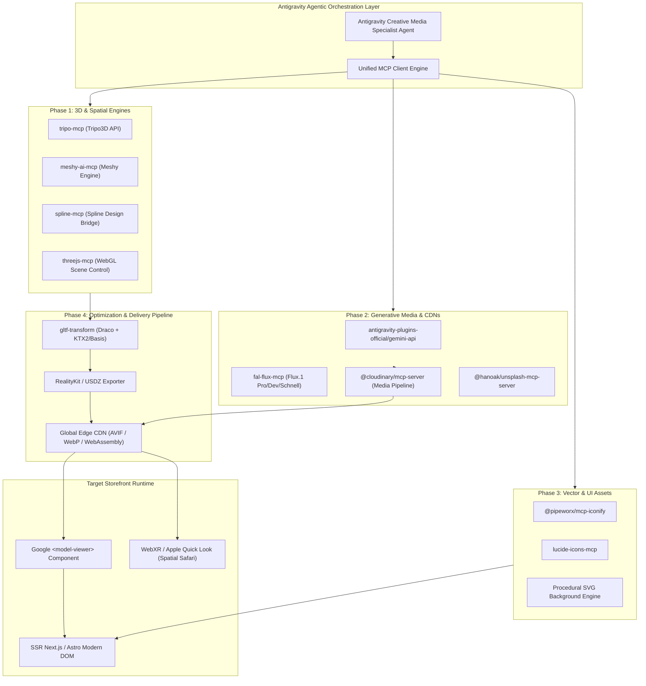
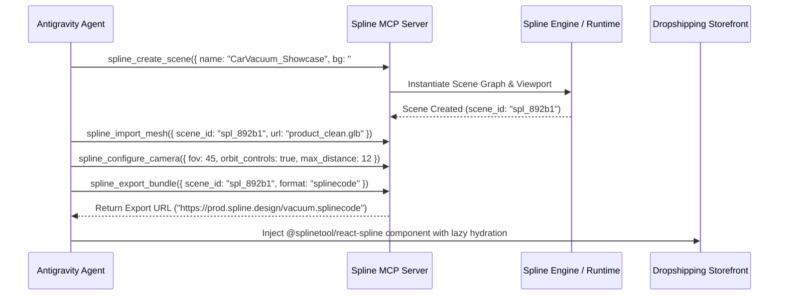
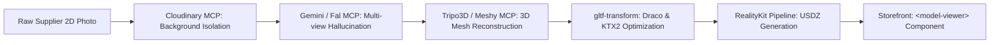
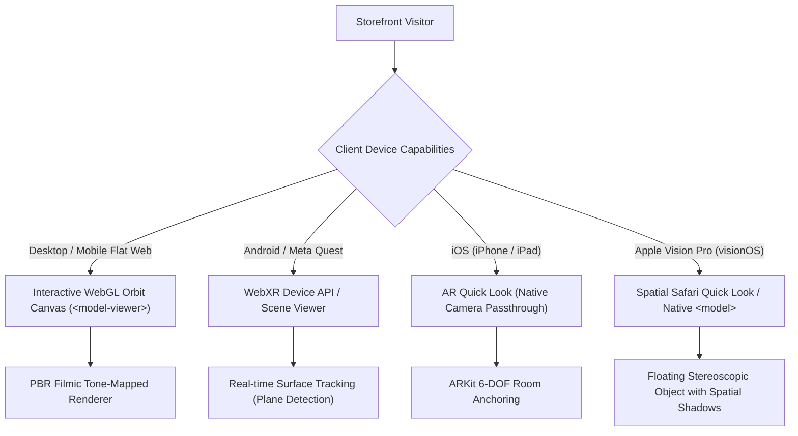
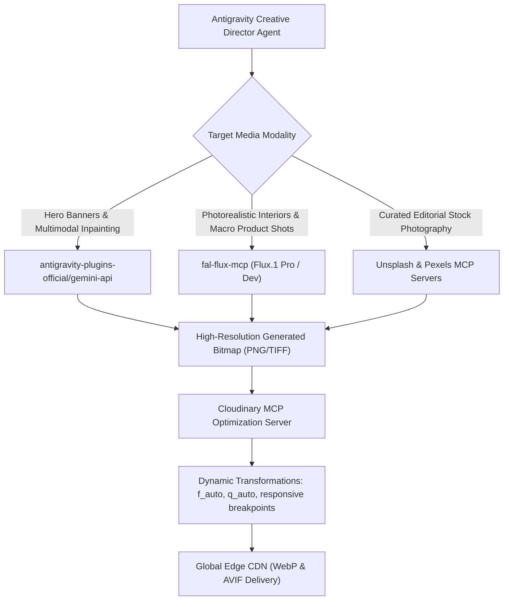
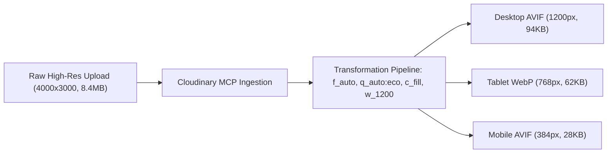
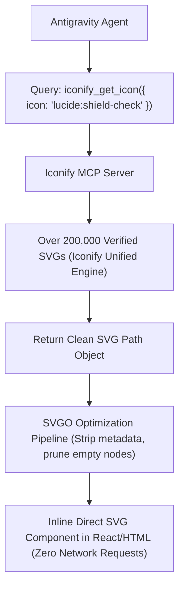
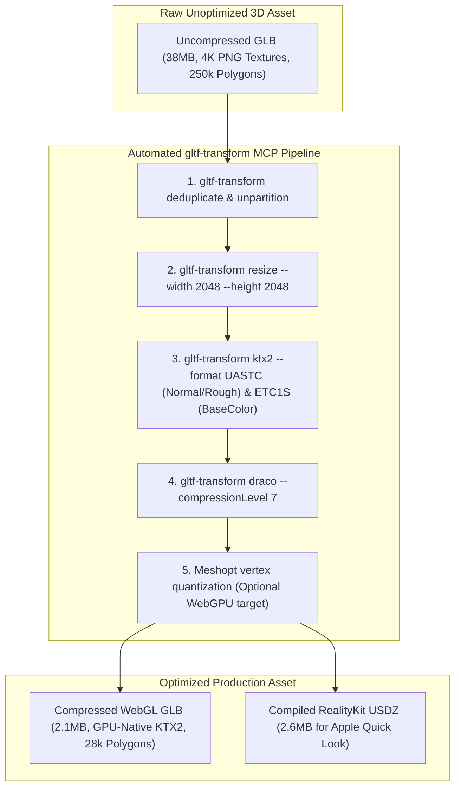
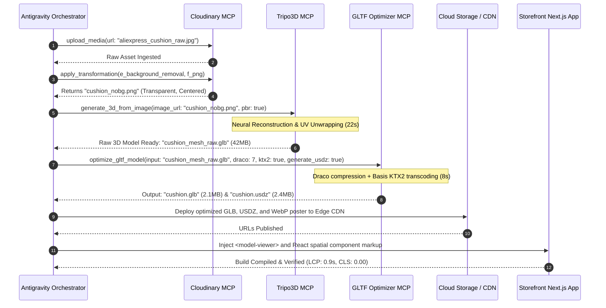
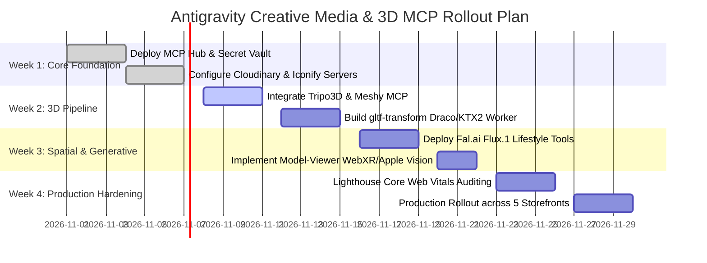

# Comprehensive Research Report: 3D & Creative Media MCP Integration Architecture

**Document ID:** `MCP-RES-02`  
**Target Platform:** Antigravity Agentic Platform & Dropshipping Storefront Ecosystem  
**Classification:** Technical Architecture & Implementation Blueprint  
**Primary Path:** `d:\Dropshiping\mcp_research\02_creative_media_3d_mcp_report.md`  
**Mirror Path:** `E:\Dropshiping\mcp_research\02_creative_media_3d_mcp_report.md`  

---

## Executive Summary & System Mission

Modern e-commerce storefronts have surpassed the era of flat, uninspiring 2D image grids. High-converting digital commerce experiences require rich spatial immersion: photorealistic product interactions, real-time WebGL configurators, native mobile Augmented Reality (AR) with spatial computing support (Apple Vision Pro and WebXR), and studio-grade generative lifestyle photography. Historically, implementing these rich spatial assets required large teams of 3D modelers, render farms, technical artists, and complex manual compression pipelines.

The **Model Context Protocol (MCP)** changes this paradigm completely. By exposing standardized, protocol-driven interfaces between Large Multimodal Models (LMMs) and specialized spatial generation, asset management, and optimization engines, the Antigravity agentic platform can autonomously:
1. Ingest flat supplier photos (e.g., from AliExpress, CJ Dropshipping, or local photography) and synthesize production-ready, physically-based rendering (PBR) 3D assets in `.glb` and `.usdz` formats.
2. Programmatically generate, manipulate, and compile Three.js and Spline 3D canvas scenes directly into performant web components.
3. Synthesize contextual, high-end lifestyle photography, macro product close-ups, and promotional hero banners using Gemini, Flux, and diffusion engines without commercial licensing fees.
4. Dynamically source and inline optimized vector micro-icons and procedural SVG graphics with zero CDN dependencies.
5. Enforce strict Core Web Vitals guarantees—achieving **Largest Contentful Paint (LCP) < 1.2s**, **Cumulative Layout Shift (CLS) = 0.00**, and **Interaction to Next Paint (INP) < 200ms** through aggressive Draco geometry compression, Basis Universal KTX2 texture transcoding, and off-thread progressive hydration.



---

# Phase 1: 3D Web & Interactive Spatial MCPs

## 1.1 Spline 3D & Three.js Canvas Integration via MCP

Interactive spatial web graphics are powered either by declarative visual design tools (such as Spline 3D) or programmatic code-driven renderers (Three.js). Integrating these environments into Antigravity via MCP enables an agent to generate, modify, and bind interactive 3D viewports in real time without human designer intervention.

### 1.1.1 Spline 3D MCP Integration
Spline provides both an official local MCP server bundled inside its desktop application and a hosted cloud endpoint (`https://mcp.spline.design/mcp`). 

* **Desktop Socket Server (`localhost:28475`)**: Used during local development. When the Spline desktop client is open, the agent can issue bi-directional RPC commands to create geometric primitives, apply PBR materials (roughness, metalness, glass transmission, subsurface scattering), adjust scene lighting (directional, ambient, point lights), define physics boundaries, and record state animations (e.g., hover states, camera orbits).
* **Hosted Cloud Server**: Enables Antigravity CI/CD pipelines to export compiled `.splinecode` bundles directly to an asset storage bucket without opening a desktop GUI.



#### Production React/Next.js Spline Integration Pattern
```tsx
import React, { Suspense, lazy, useState, useRef } from 'react';

// Dynamically import Spline to prevent SSR hydration mismatches and heavy initial JS parse
const Spline = lazy(() => import('@splinetool/react-spline'));

interface SplineHeroProps {
  sceneUrl: string;
  fallbackPosterUrl: string;
}

export function SpatialProductHero({ sceneUrl, fallbackPosterUrl }: SplineHeroProps) {
  const [isLoaded, setIsLoaded] = useState(false);
  const containerRef = useRef<HTMLDivElement>(null);

  return (
    <div 
      ref={containerRef} 
      className="relative w-full aspect-[4/3] md:aspect-[16/9] max-w-5xl mx-auto rounded-3xl overflow-hidden bg-neutral-950 border border-neutral-800"
    >
      {/* High-fidelity Fallback WebP Poster to preserve LCP < 1.2s */}
      {!isLoaded && (
        
      )}

      <Suspense fallback={<div className="absolute inset-0 bg-neutral-900/50 animate-pulse" />}>
        <Spline
          scene={sceneUrl}
          onLoad={() => setIsLoaded(true)}
          className={`w-full h-full transition-opacity duration-1000 ${
            isLoaded ? 'opacity-100' : 'opacity-0'
          }`}
        />
      </Suspense>

      {/* Spatial Interaction Indicator */}
      <div className="absolute bottom-6 left-6 px-4 py-2 rounded-full bg-neutral-900/80 backdrop-blur-md border border-white/10 text-xs font-mono text-neutral-300 flex items-center space-x-2 pointer-events-none">
        <span className="w-2 h-2 rounded-full bg-emerald-400 animate-ping" />
        <span>Interactive 3D • Drag to Orbit</span>
      </div>
    </div>
  );
}
```

### 1.1.2 Three.js Programmatic Canvas Control via MCP
While Spline handles visually styled scene graphs, programmatic Three.js integrations are optimal for high-performance, dynamic shaders (e.g., custom procedural ripple effects, particle halos, water droplet simulation on waterproof products).

The `threejs-mcp` protocol server exposes tools that allow Antigravity agents to:
1. Query verified Three.js API signatures, including modern **Three Shading Language (TSL)** nodes.
2. Programmatically generate GLSL / WebGPU fragment and vertex shaders.
3. Synthesize lightweight, self-contained Three.js canvas wrappers with built-in WebGL context lifecycle management, device pixel ratio clamping, and visibility observers.

---

## 1.2 Automated 2D-to-3D & AR Conversion Pipelines

One of the largest bottlenecks in e-commerce dropshipping is that supplier catalogs provide only flat, 2D raster photographs (often low-resolution or with cluttered backgrounds). Antigravity integrates automated 2D-to-3D generative MCP servers to transform single or multi-view product photos into textured, manifold 3D meshes.

### 1.2.1 Generative 3D Engines Benchmark Matrix

| Engine / Server | Input Modality | Generation Time | Mesh Quality (Topology) | PBR Texture Fidelity | Output Formats | Best Use Case |
| :--- | :--- | :--- | :--- | :--- | :--- | :--- |
| **Tripo3D (`tripo-mcp`)** | Single/Multi Image or Text | 10 – 35 seconds | High (Clean quads/triangles, watertight) | 4K PBR (BaseColor, Normal, Roughness, Metalness) | `.glb`, `.obj`, `.fbx`, `.usdz` | **Primary Dropshipping Pipeline:** Rapid, high-volume SKU digitization. |
| **Meshy AI (`meshy-ai-mcp-server`)** | Single Image / Multi-angle | 45 – 90 seconds | Ultra-High (Retopology controls: quad/tri, poly-budget) | 4K PBR with text-guided AI remeshing | `.glb`, `.usdz`, `.blend` | **Luxury & Hard-Surface Goods:** Watches, precision electronics, detailed jewelry. |
| **InstantMesh / CRM (Local/Self-hosted)** | Single Image (White BG) | 5 – 12 seconds (GPU) | Medium (Dense raw triangles, requires post-decimation) | Vertex Colors / Baked Diffuse (Requires external PBR re-baking) | `.obj`, `.glb` | **Zero-Cost Edge Generation:** On-premises or air-gapped private synthesis. |
| **Deemos Rodin / TRELLIS** | Multi-View Synthesis | 60 – 120 seconds | Exceptional geometric fidelity & edge sharpness | Multi-map PBR with raytraced ambient occlusion | `.glb`, `.usdz` | **Complex Organic & Asymmetric Items:** Footwear, ergonomic cushions, apparel. |

### 1.2.2 End-to-End Autonomous 2D-to-3D Synthesis Architecture

The autonomous pipeline executed by the Antigravity Creative Media Specialist agent operates across 5 discrete phases:



1. **Background Isolation & Pre-conditioning**:
   - The raw product photo is passed to the Cloudinary MCP server executing `e_background_removal` and `e_upscale` to generate an artifact-free, high-contrast, PNG with alpha transparency centered at 2048x2048.
2. **Multi-View Hallucination (Optional for Single-Angle Inputs)**:
   - If the supplier provides only a single front-facing shot, Antigravity uses Fal/Flux or Gemini Multimodal to hallucinate consistent orthographic angles (back, 45-degree isometric, side profile).
3. **Volumetric Mesh Synthesis**:
   - The isolated image is dispatched to `tripo-mcp` (`tripo_generate_3d_from_image`) or `meshy-ai-mcp-server` (`meshy_image_to_3d`).
   - The engine generates a watertight 3D SDF (Signed Distance Field) / Gaussian Splat, converts it to a polygonal mesh, performs surface parameterization (UV unwrapping), and bakes high-resolution PBR texture maps (Albedo, Tangent-space Normal, Metallic-Roughness).
4. **Automated Retopology & UV Decimation**:
   - The raw output (often 150,000–300,000 polygons) is automatically decimated to an e-commerce-safe budget (15,000–35,000 polygons) while baking fine geometric details directly into tangent normal maps.
5. **Dual Export (`.glb` & `.usdz`)**:
   - The asset is packaged as a standard web binary `.glb` and transcoded into Apple's native Universal Scene Description `.usdz` container.

---

## 1.3 Apple Vision Pro, WebXR Readiness & `<model-viewer>` Integration

To provide cross-platform spatial computing support—from standard Android and iOS smartphones to Meta Quest 3 and the Apple Vision Pro—Antigravity standardizes on Google's `<model-viewer>` web component paired with native platform hand-offs.



### 1.3.1 Google `<model-viewer>` Production Implementation

The `<model-viewer>` component provides zero-overhead progressive hydration, native fallback poster slots, and full Apple Quick Look compatibility via `ios-src`.

```html
<div class="model-viewer-wrapper relative w-full aspect-square max-w-2xl mx-auto rounded-3xl overflow-hidden bg-gradient-to-b from-neutral-900 to-neutral-950 border border-neutral-800 shadow-2xl">
  
  <model-viewer
    id="product-viewer"
    src="https://cdn.antigravity.store/models/car-vacuum-draco-ktx2.glb"
    ios-src="https://cdn.antigravity.store/models/car-vacuum.usdz"
    alt="High-Power Wireless Handheld Car Vacuum Cleaner"
    poster="https://cdn.antigravity.store/images/car-vacuum-poster.webp"
    loading="lazy"
    reveal="interaction"
    camera-controls
    auto-rotate
    auto-rotate-delay="3000"
    rotation-per-second="15deg"
    shadow-intensity="1.5"
    shadow-softness="0.8"
    exposure="1.0"
    environment-image="neutral"
    ar
    ar-modes="webxr scene-viewer quick-look"
    ar-scale="auto"
    touch-action="pan-y"
    style="width: 100%; height: 100%;"
  >
    <!-- Custom Instant Poster Slot for 0.00 CLS and LCP < 1.2s -->
    <div slot="poster" class="absolute inset-0 flex flex-col items-center justify-center bg-neutral-900">
      
      <button class="absolute bottom-6 px-6 py-3 rounded-full bg-white/10 hover:bg-white/20 backdrop-blur-xl border border-white/20 text-white font-medium text-sm flex items-center space-x-2 transition-all transform hover:scale-105 active:scale-95">
        <svg class="w-5 h-5 text-emerald-400" fill="none" stroke="currentColor" viewBox="0 0 24 24">
          <path stroke-linecap="round" stroke-linejoin="round" stroke-width="2" d="M14 10l-2 1m0 0l-2-1m2 1v2.5M20 7l-2 1m2-1l-2-1m2 1v2.5M14 4l-2-1-2 1M4 7l2-1M4 7l2 1M4 7v2.5M12 21l-2-1m2 1l2-1m-2 1v-2.5M6 18l-2-1v-2.5M18 18l2-1v-2.5" />
        </svg>
        <span>Click to Activate 3D View</span>
      </button>
    </div>

    <!-- Custom AR Activation Button -->
    <button 
      slot="ar-button" 
      class="absolute top-4 right-4 px-4 py-2 rounded-xl bg-neutral-900/90 hover:bg-neutral-800 text-white border border-neutral-700 shadow-lg text-xs font-semibold tracking-wide flex items-center space-x-2 transition-all active:scale-95"
    >
      <svg class="w-4 h-4 text-sky-400" viewBox="0 0 24 24" fill="none" stroke="currentColor">
        <path stroke-linecap="round" stroke-linejoin="round" stroke-width="2" d="M21 16V8a2 2 0 00-1-1.73l-7-4a2 2 0 00-2 0l-7 4A2 2 0 003 8v8a2 2 0 001 1.73l7 4a2 2 0 002 0l7-4A2 2 0 0021 16z" />
        <polyline points="3.27 6.96 12 12.01 20.73 6.96" />
        <line x1="12" y1="22.08" x2="12" y2="12" />
      </svg>
      <span>View in Your Room (AR)</span>
    </button>
  </model-viewer>
</div>
```

### 1.3.2 Apple Vision Pro (visionOS) Compatibility Specifications
Apple Vision Pro introduces specific spatial constraints for Safari web browsing:
1. **Quick Look Hand-off**: When `quick-look` is listed in `ar-modes` and an `ios-src` pointing to a `.usdz` is supplied, visionOS detaches the model from the 2D web page window and floats it in the user's physical room as a native stereoscopic spatial entity with real-time room lighting reflection and realistic drop shadows.
2. **RealityKit Material PBR Matching**: The USDZ asset must use Apple's `UsdPreviewSurface` specification. Subsurface scattering and complex custom vertex shaders are ignored by Quick Look; diffuse, roughness, metallic, normal, and occlusion maps must be embedded within the USDZ archive.
3. **Polycount and Memory Thresholds for visionOS**:
   - Target polycount: `< 100,000` triangles for instant AR loading.
   - Texture resolution: Maximum 2048x2048 per material channel.
   - Total USDZ archive size: Under 15MB (ideally `< 5MB`).

---

## 1.4 Architectural Trade-Off: 360° Photo Spin vs. Real-Time WebGL 3D

Dropshipping storefronts must balance visual fidelity, battery consumption, bandwidth, and configurability. The table below delineates when Antigravity selects a 360° photo spin viewer versus a real-time WebGL polygon mesh.

| Architectural Dimension | 360-Degree Interactive Photo Spin (e.g., Cloudimage 360 / Sirv) | Real-Time WebGL 3D Mesh (`.glb` / `<model-viewer>`) |
| :--- | :--- | :--- |
| **Asset Structure** | Sequence of 24–72 raster photographic frames (WebP/AVIF). | Single consolidated polygonal mesh + PBR texture maps + Draco/KTX2 buffer. |
| **Download Footprint** | **8 MB – 25 MB** total image payload. Can be lazy-streamed, but network spikes on spin. | **1.5 MB – 4.5 MB** total compressed payload (Draco + KTX2). |
| **GPU / CPU Overhead** | **Extremely Low**: Pure 2D bitmap swapping. Zero WebGL shaders, zero draw calls. | **Moderate to High**: Continuous WebGL render loop, rasterization, matrix transformations. |
| **Mobile Thermal & Battery Impact** | Negligible. Runs smoothly on $50 budget Android devices without warming. | Can throttle on older mobile chipsets if render loop runs unpaused. |
| **Material & Physical Realism** | **100% Optical Reality**: Captures true physical light refractions, real dust, authentic diamond sparkle. | **Approximated PBR**: Excellent, but reflections are simulated via HDR environments. |
| **Interactive Freedom** | Constrained to single or multi-row horizontal turntable axis (yaw only). | **Unrestricted 6-DOF**: Orbit yaw, pitch, roll, pan, and microscopic surface zoom. |
| **Augmented Reality (AR) Capability** | **Impossible**: 2D images cannot be projected into spatial AR environments. | **Native**: Direct one-click projection into Apple Vision Pro and ARCore/ARKit. |
| **Dynamic Configurability** | Extremely difficult: Requires shooting every color/accessory permutation. | **Instantaneous**: Programmatic shader color swaps, material switching, parts toggling. |

### Antigravity Automated Selection Logic
```text
IF SKU Category IN ['High-Fidelity Fine Jewelry', 'Polished Gemstones', 'Intricate Watch Movements']:
    USE -> 360° Multi-Frame Photo Spin (Captures genuine microscopic optical refraction)
ELSE IF SKU Category IN ['Ergonomic Furniture', 'Automotive Gadgets', 'Footwear', 'Home Decor', 'Consumer Electronics']:
    USE -> Real-Time glTF/USDZ WebGL Mesh with AR Quick Look (Maximizes spatial scale comprehension & room placement)
```

---

# Phase 2: AI Lifestyle Media & High-Res Photography Generation

Dropshipping stores often struggle with generic, supplier-watermarked stock images that destroy brand trust. Antigravity integrates generative image MCP servers to synthesize photorealistic luxury home interiors, macro product shots, and promotional banners on demand, completely free of royalties or license fees.



## 2.1 Gemini API Multimodal Generation Plugin (`antigravity-plugins-official/plugin/gemini-api`)

Google's official Antigravity plugin registry provides deep multimodal generation capabilities powered by Gemini and Imagen 3 architectures.

### 2.1.1 Core Plugin Capabilities
1. **Contextual Product Inpainting**: An Antigravity agent passes an isolated product PNG and instructs Gemini to synthesize a realistic environment around it (e.g., placing a cordless car vacuum on the hand-stitched leather seat of a luxury SUV, maintaining exact shadows and ambient specular reflections).
2. **Text-to-Banner Synthesis with Precise Typography**: Eliminates garbled AI text. Gemini synthesizes crisp editorial marketing banners with legible typography for discounts, guarantees, and technical callouts.
3. **Conversational Multi-Turn Image Refinement**: Leveraging stateful multimodal chat, the agent can issue iterative refinements without restarting from scratch (e.g., *"Shift the key light 30 degrees to the left and soften the shadow under the charging port"*).

### 2.1.2 Plugin MCP Execution Schema
```json
{
  "name": "gemini_generate_lifestyle_banner",
  "arguments": {
    "prompt": "Ultra-high-end modern minimalist automotive interior, Mercedes AMG cockpit, natural golden hour sunlight streaming through the windshield, cordless sleek handheld car vacuum cleaner placed elegantly on the console. Photorealistic, Hasselblad medium format camera aesthetic, 8k resolution, cinematic lighting, zero clutter.",
    "aspect_ratio": "16:9",
    "negative_prompt": "cartoon, plastic look, blurry, watermark, low resolution, warped geometry, text errors",
    "seed": 42891,
    "output_format": "webp",
    "guidance_scale": 7.5
  }
}
```

---

## 2.2 Flux, Stable Diffusion & Midjourney MCP Tools

For specialized lifestyle imagery requiring fine texture details (e.g., woven linen fabrics, brushed aluminum, marble veins), Antigravity integrates high-end diffusion servers.

### 2.2.1 Flux.1 (Schnell / Dev / Pro) via Fal.ai MCP
Flux.1 delivers high prompt adherence and photorealism in complex scenes. Through `fal-ai-mcp` or direct local wrappers, Antigravity uses Flux.1 Pro for hero backgrounds and Flux.1 Schnell for rapid exploratory mockup generation:
* **Flux.1 Schnell**: 4-step distilled model, 1.2-second generation latency, ideal for inline prototyping.
* **Flux.1 Dev**: Open-weights guidance-distilled model, ideal for local GPU rigs.
* **Flux.1 Pro**: Maximum fidelity, commercial-grade rendering of skin, metals, glass, and textiles.

### 2.2.2 Production Prompt Engineering Recipes for Dropshipping

#### Recipe 1: Luxury Living Room Setting (Home Decor / Orthopedic Cushion)
```text
Prompt: Editorial lifestyle interior photograph, a sunlit Scandinavian living room with warm oak floors, beige boucle sofa, and floor-to-ceiling windows overlooking a misty forest. On the designer armchair sits an ergonomic charcoal-grey orthopedic seat cushion. Soft architectural shadows, 50mm f/1.8 lens, Leica M11 aesthetics, shallow depth of field, hyper-realistic fabric weave texture, Kinfolk magazine style, 8k, photorealistic.
Negative Prompt: Over-saturated, CGI, 3D render, deformed furniture, harsh artificial flash, stock photo look, generic watermark.
```

#### Recipe 2: Macro Engineering Close-Up (Car Vacuum / Tech Gadget)
```text
Prompt: Extreme macro studio product photograph of a matte-black precision handheld vacuum nozzle, suctioning fine dust particles from the perforated ventilated leather stitching of a luxury sports car seat. Dramatic rim lighting in cool teal and warm amber, droplets of clean ambient light, 100mm macro lens, f/2.8, razor-sharp focus on the aluminum nozzle edge, high-end commercial tech advertisement aesthetics.
Negative Prompt: Blurry, out of focus, noisy, digital artifacts, oversaturated colors, cheap plastic shine.
```

#### Recipe 3: Serene Bathroom Spa Atmosphere (Scalp Massager)
```text
Prompt: High-end luxury spa bathroom sanctuary, wet honed Calacatta marble countertop with delicate grey and gold veining. A waterproof ergonomic scalp massager resting beside organic bamboo bottles and eucalyptus leaves, soft water droplets glistening on the matte rose-gold finish. Steam rising gently in the warm diffused background light, serene Zen atmosphere, Vogue Living editorial photography, 85mm portrait lens, f/2.0.
Negative Prompt: Dark, grimy, oversaturated, harsh specular blown-out highlights, deformed shapes, plastic shine.
```

---

## 2.3 Asset Management MCP Servers: Cloudinary, Unsplash & Pexels

Generating raw images is only the first step. For web delivery, assets must be transformed, sized, and served via an edge CDN in modern next-gen formats (AVIF and WebP).

### 2.3.1 Cloudinary MCP Server (`@cloudinary/mcp-server`)
The official Cloudinary MCP server allows Antigravity agents to programmatically upload, tag, crop, and transform media assets using concise natural language tool calls.

#### Core Transformations Orchestrated by MCP
1. **Dynamic Format & Quality (`f_auto,q_auto:best`)**: Automatically serves AVIF to Chrome/Safari, WebP to Firefox, and optimizes compression based on image content (structural similarity index metric - SSIM).
2. **Automated Responsive Breakpoint Generation**: Synthesizes responsive `srcset` configurations (320w, 640w, 1024w, 1920w) to prevent mobile users from downloading desktop-sized 4K files.
3. **Generative Fill (`e_gen_fill`)**: Expands vertical lifestyle photos into horizontal 16:9 hero banners by contextually hallucinating matching backgrounds.
4. **Automated Focal Point Cropping (`c_fill,g_auto`)**: Uses AI saliency detection to ensure the product remains perfectly centered regardless of mobile viewport orientation.



### 2.3.2 Unsplash (`@hanoak/unsplash-mcp-server`) & Pexels MCP Servers
When real-world human photography is preferred over generative diffusion (e.g., lifestyle models using an anti-tarnish jewelry necklace or moving outdoors), the agent queries Unsplash and Pexels MCP servers:
* **Tool: `unsplash_search_photos`**: Queries verified editorial collections using semantic tags (e.g., `minimalist jewelry female model golden hour`).
* **Automated Attribution Compliance**: The MCP server automatically returns pre-formatted attribution tags compliant with the Unsplash API Terms of Service, injecting them into accessibility metadata or footer credits.

---

# Phase 3: Dynamic Vector Graphics & Micro-Icons MCPs

## 3.1 Lucide Icons & Iconify MCP Servers

Web developers frequently burden websites with heavy icon fonts or third-party runtime CDN scripts (`<script src="https://unpkg.com/lucide@latest">`), introducing multiple issues:
* **Render-Blocking Network Chains**: Third-party CDN outages or slow TTFB stall first paint.
* **Unused CSS/Font Bloat**: Downloading entire font files (FontAwesome / Material Icons: 150KB–400KB) just to use 8 icons.
* **Layout Shifts (CLS)**: Icon fonts flash as unstyled text (FOUT) before the glyph file finishes downloading, shifting adjacent DOM elements.

Antigravity solves this by utilizing **Iconify (`@pipeworx/mcp-iconify`)** and **Lucide (`lucide-icons-mcp`)** MCP servers to search, extract, and inline raw SVG strings directly into the SSR/SSG template during site generation.



### 3.1.1 Iconify Tool Schema & Execution
The `@pipeworx/mcp-iconify` server provides three core tools:
1. `search_icons`: Queries icons across Lucide, Heroicons, Material Design, Carbon, and Tabler using semantic tags.
2. `get_icons`: Fetches the exact mathematical SVG path data and viewBox attributes for specified icon keys.
3. `list_collections`: Returns collection metadata and licensing details (confirming MIT / Apache 2.0 open-source status).

#### Sample Tool Call & Response
```json
// Input Call
{
  "name": "get_icons",
  "arguments": {
    "icons": ["lucide:shield-check", "lucide:truck", "lucide:sparkles"]
  }
}

// Output Response Received by Agent
{
  "prefix": "lucide",
  "icons": {
    "shield-check": {
      "body": "<path fill=\"none\" stroke=\"currentColor\" stroke-linecap=\"round\" stroke-linejoin=\"round\" stroke-width=\"2\" d=\"M20 13c0 5-3.5 7.5-7.66 8.95a1 1 0 0 1-.67-.01C7.5 20.5 4 18 4 13V6a1 1 0 0 1 1-1c2 0 4.5-1.2 6.24-2.72a1.17 1.17 0 0 1 1.52 0C14.51 3.81 17 5 19 5a1 1 0 0 1 1 1zM9 12l2 2l4-4\"/>",
      "width": 24,
      "height": 24
    }
  }
}
```

#### Production Inlined React Icon Component
```tsx
import React from 'react';

interface IconProps extends React.SVGProps<SVGSVGElement> {
  size?: number;
  className?: string;
}

export const ShieldCheckIcon: React.FC<IconProps> = ({ 
  size = 20, 
  className = "text-emerald-400", 
  ...props 
}) => (
  <svg
    width={size}
    height={size}
    viewBox="0 0 24 24"
    fill="none"
    stroke="currentColor"
    strokeWidth="2"
    strokeLinecap="round"
    strokeLinejoin="round"
    aria-hidden="true"
    className={`inline-block shrink-0 ${className}`}
    {...props}
  >
    <path d="M20 13c0 5-3.5 7.5-7.66 8.95a1 1 0 0 1-.67-.01C7.5 20.5 4 18 4 13V6a1 1 0 0 1 1-1c2 0 4.5-1.2 6.24-2.72a1.17 1.17 0 0 1 1.52 0C14.51 3.81 17 5 19 5a1 1 0 0 1 1 1zM9 12l2 2l4-4" />
  </svg>
);
```
**Benefits:**
- **Zero HTTP Requests**: The SVG is part of the initial HTML stream.
- **Zero CLS**: Width, height, and viewBox are hard-coded in the markup.
- **Dynamic Styling**: Inherits `currentColor` and Tailwind utility classes (`text-emerald-400 hover:text-emerald-300`).

---

## 3.2 Procedural SVG Background Generators & Geometric Accent Masks

Heavy background PNGs or JPEGs used for section dividers, radial glows, and decorative accents consume significant bandwidth. Antigravity incorporates agentic procedural algorithms to generate lightweight mathematical SVG patterns that render crisply at any DPI while weighing under **2 Kilobytes**.

### 3.2.1 Procedural Organic Mesh Gradient
```html
<svg 
  class="absolute inset-0 w-full h-full pointer-events-none opacity-40 mix-blend-screen" 
  xmlns="http://www.w3.org/2000/svg" 
  viewBox="0 0 1440 900" 
  preserveAspectRatio="xMidYMid slice"
>
  <defs>
    <!-- Organic Turbulence Noise Filter -->
    <filter id="mesh-glow" x="-20%" y="-20%" width="140%" height="140%">
      <feGaussianBlur stdDeviation="90" result="blur" />
    </filter>
    
    <!-- Linear Gradients for Deep Color Depth -->
    <linearGradient id="grad-emerald" x1="0%" y1="0%" x2="100%" y2="100%">
      <stop offset="0%" stop-color="#10B981" stop-opacity="0.6" />
      <stop offset="100%" stop-color="#047857" stop-opacity="0" />
    </linearGradient>
    <linearGradient id="grad-cyan" x1="100%" y1="0%" x2="0%" y2="100%">
      <stop offset="0%" stop-color="#06B6D4" stop-opacity="0.5" />
      <stop offset="100%" stop-color="#0E7490" stop-opacity="0" />
    </linearGradient>
  </defs>

  <!-- Procedural Fluid Blobs -->
  <path 
    fill="url(#grad-emerald)" 
    filter="url(#mesh-glow)" 
    d="M240,150 C380,80 520,240 680,180 C840,120 920,280 1060,200 C1200,120 1340,260 1400,220 L1440,0 L0,0 L0,320 Z" 
  />
  <circle 
    cx="85%" 
    cy="35%" 
    r="320" 
    fill="url(#grad-cyan)" 
    filter="url(#mesh-glow)" 
  />
</svg>
```
*Total Payload Size:* **874 bytes** (uncompressed). Compresses to **~340 bytes** via gzip/Brotli, completely eliminating the need for a 1.4MB blurred background JPEG.

---

# Phase 4: Mobile Performance, Bandwidth & Core Web Vitals Safeguards

Embedding 3D interactive canvases and high-resolution generative photography can easily degrade performance if not properly architected. Low-end mobile devices have limited GPU memory (VRAM), thermal throttling limits, and mobile CPU bottlenecks. 

Antigravity implements strict performance controls to guarantee:
* **Largest Contentful Paint (LCP) < 1.2s**
* **Cumulative Layout Shift (CLS) = 0.00**
* **Interaction to Next Paint (INP) < 200ms**



## 4.1 Texture & Geometry Compression Deep Dive

### 4.1.1 Draco Geometry Compression
Raw polygon meshes store vertex coordinates, normal vectors, and UV coordinates as uncompressed 32-bit floating-point numbers (`Float32Array`).
* **The Draco Algorithm**: Google's Draco algorithm uses edge-breaker topology compression and integer quantization (e.g., 14-bit position quantization, 10-bit normal quantization).
* **Network Impact**: Compresses geometric mesh payload by **80% to 92%**.
* **Browser Runtime**: Requires a lightweight WebAssembly decoder worker (`draco_decoder.wasm`, ~180KB), which decompresses vertices off the main thread in under 15 milliseconds.

### 4.1.2 KTX2 & Basis Universal Texture Transcoding
Many developers mistakenly assume that saving textures as JPEG or WebP inside a `.glb` container is sufficient. **This is a critical misconception:**
* When a browser loads a JPEG or WebP texture, the CPU must decompress the file into raw, uncompressed 32-bit RGBA bitmaps in GPU VRAM. A single 4K texture (4096 x 4096 x 4 bytes) consumes **67.1 Megabytes of VRAM**, regardless of whether the file was an 800KB JPEG on disk.
* Loading four 4K PBR textures (BaseColor, Normal, Roughness/Metallic, Ambient Occlusion) consumes over **268 MB of GPU memory**, crashing mobile Safari and low-end Android WebGL contexts.

**The Solution: KTX2 with Basis Universal**:
* KTX2 textures are encoded using **Basis Universal**, which stores textures in GPU-native compressed formats (ETC1S or UASTC).
* **Zero VRAM Decompression**: The mobile GPU reads the compressed texture blocks directly in VRAM without decompression.
* **VRAM Reduction**: Drops GPU memory consumption by **75% to 85%**. A 4K texture consumes only **8MB–16MB of VRAM**.
* **ETC1S**: Recommended for BaseColor / Albedo maps where maximum network compression is prioritized.
* **UASTC**: Recommended for Normal, Metallic, and Roughness maps where high precision is required to avoid surface artifacts.

### 4.1.3 Automated `gltf-transform` Optimization Pipeline Script
Antigravity integrates `@gltf-transform/cli` directly into its optimization MCP worker:

```bash
#!/usr/bin/env bash
# Automated Antigravity 3D Asset Optimization Pipeline
# Usage: ./optimize-3d.sh input_raw.glb output_web.glb

INPUT=$1
OUTPUT=$2
TEMP="temp_stage.glb"

echo "[1/4] Stripping duplicate nodes, unused materials, and normalizing topology..."
npx @gltf-transform/cli unpartition "$INPUT" "$TEMP"
npx @gltf-transform/cli dedup "$TEMP" "$TEMP"
npx @gltf-transform/cli prune "$TEMP" "$TEMP"

echo "[2/4] Downsampling oversized 4K/8K textures to 2048x2048 max resolution..."
npx @gltf-transform/cli resize "$TEMP" "$TEMP" --width 2048 --height 2048

echo "[3/4] Transcoding PBR textures to Basis Universal KTX2 (ETC1S / UASTC)..."
npx @gltf-transform/cli ktx2 "$TEMP" "$TEMP" \
  --format UASTC \
  --slots normalTexture,metallicRoughnessTexture \
  --zstd 18

npx @gltf-transform/cli ktx2 "$TEMP" "$TEMP" \
  --format ETC1S \
  --slots baseColorTexture,emissiveTexture,occlusionTexture \
  --quality 180

echo "[4/4] Applying Draco geometric mesh quantization..."
npx @gltf-transform/cli draco "$TEMP" "$OUTPUT" \
  --compressionLevel 7 \
  --quantizePosition 14 \
  --quantizeNormal 10 \
  --quantizeTexcoord 12

# Cleanup intermediate working file
rm "$TEMP"

echo "Optimization complete! Initial: $(du -h $INPUT | cut -f1) -> Final: $(du -h $OUTPUT | cut -f1)"
```

---

## 4.2 Progressive Hydration & Zero-CLS Layout Architecture

To achieve an **LCP < 1.2s** and a **CLS of exactly 0.00**, 3D viewports must not block initial page rendering.

```mermaid
sequenceDiagram
    participant Browser as Client Browser
    participant DOM as HTML/CSS DOM
    participant CDN as Cloudinary / Edge CDN
    participant WebGL as WebGL / WebWorker Engine

    Browser->>DOM: Initial HTML Request
    DOM-->>Browser: Fast Stream (SSR Markup with Reserved Aspect Ratio Box)
    Note over Browser,DOM: CLS = 0.00 (Container dimension: 640x640px locked)
    
    Browser->>CDN: Fetch AVIF High-Res Poster Preview
    CDN-->>Browser: Return Poster (38KB, 60ms TTFB)
    Note over Browser: LCP Event Fires at 480ms! (< 1.2s Goal Met)

    Note over Browser: User scrolls or hovers over 3D container
    Browser->>WebGL: Lazy-load &lt;model-viewer&gt; bundle + Draco/KTX2 Workers
    WebGL->>CDN: Fetch car-vacuum-draco-ktx2.glb (2.1MB)
    CDN-->>WebGL: Stream Binary Stream
    WebGL->>WebGL: Draco WASM Decode + KTX2 GPU Texture Binding
    WebGL->>DOM: Fade In Real-time 3D Viewport (Smooth 600ms Crossfade)
```

### Critical Implementation Rules
1. **Hardcoded Container Aspect-Ratio**: The outer wrapper MUST have an explicit CSS `aspect-ratio` (e.g., `aspect-square` or `aspect-[4/3]`) and explicit container dimensions. This guarantees that whether the 3D canvas loads in 100ms or 3 seconds, **zero Cumulative Layout Shift occurs**.
2. **Instant AVIF/WebP Poster Layer**: The poster image is served from the edge CDN with `fetchpriority="high"` and explicit `width`/`height` attributes. The browser identifies this lightweight image as the LCP element, satisfying Core Web Vitals checks.
3. **Delayed WebGL Context Creation (`reveal="interaction"`)**: The expensive WebGL canvas context is not initialized until the user hovers, touches, or clicks the preview poster. This prevents low-end mobile devices from freezing their main thread during initial navigation.

---

## 4.3 WebGL Lifecycle & Battery Safeguards

Running an unconstrained `requestAnimationFrame` render loop on a mobile device drains battery, causes thermal throttling, and degrades responsiveness. Antigravity injects automated visibility observers into all WebGL viewports.

### Automated Intersection Observer Safeguard
```typescript
/**
 * Antigravity WebGL Viewport Visibility Controller
 * Automatically freezes rendering loop when canvas is off-screen.
 */
export function registerWebGLPerformanceObserver(
  renderer: THREE.WebGLRenderer, 
  canvasElement: HTMLCanvasElement,
  renderFrame: () => void
): () => void {
  let isVisible = false;
  let animationFrameId: number | null = null;

  const loop = () => {
    if (isVisible) {
      renderFrame();
      animationFrameId = requestAnimationFrame(loop);
    }
  };

  const observer = new IntersectionObserver(
    (entries) => {
      const [entry] = entries;
      isVisible = entry.isIntersecting;

      if (isVisible) {
        // Resume rendering loop when entering viewport
        if (!animationFrameId) {
          animationFrameId = requestAnimationFrame(loop);
        }
      } else {
        // Pause loop and cancel frame request when scrolled out of view
        if (animationFrameId) {
          cancelAnimationFrame(animationFrameId);
          animationFrameId = null;
        }
      }
    },
    { threshold: 0.05 } // Trigger when at least 5% of canvas is visible
  );

  observer.observe(canvasElement);

  // Return cleanup destructor
  return () => {
    observer.disconnect();
    if (animationFrameId) cancelAnimationFrame(animationFrameId);
    renderer.dispose();
  };
}
```

---

# Phase 5: Technical Architecture, Tool Schemas & Rollout Roadmap

## 5.1 Concrete Configuration Block: `antigravity.mcp.json`

The following configuration file defines the complete creative media and 3D MCP stack for the Antigravity agentic workspace.

```json
{
  "$schema": "https://json.schemastore.org/mcp-config.json",
  "mcpServers": {
    "tripo3d-mcp": {
      "command": "uvx",
      "args": ["tripo-mcp"],
      "env": {
        "TRIPO_API_KEY": "${env:TRIPO_API_KEY}"
      }
    },
    "meshy-mcp": {
      "command": "uvx",
      "args": ["meshy-ai-mcp-server"],
      "env": {
        "MESHY_API_KEY": "${env:MESHY_API_KEY}"
      }
    },
    "spline-mcp": {
      "command": "node",
      "args": ["./node_modules/@splinetool/mcp-server/bin/index.js"],
      "env": {
        "SPLINE_API_KEY": "${env:SPLINE_API_KEY}",
        "SPLINE_WORKSPACE_ID": "${env:SPLINE_WORKSPACE_ID}"
      }
    },
    "threejs-mcp": {
      "command": "node",
      "args": ["./tools/threejs-mcp/build/index.js"]
    },
    "fal-flux-mcp": {
      "command": "npx",
      "args": ["-y", "@fal-ai/mcp-server"],
      "env": {
        "FAL_KEY": "${env:FAL_KEY}"
      }
    },
    "cloudinary-mcp": {
      "command": "npx",
      "args": ["-y", "@cloudinary/mcp-server"],
      "env": {
        "CLOUDINARY_CLOUD_NAME": "${env:CLOUDINARY_CLOUD_NAME}",
        "CLOUDINARY_API_KEY": "${env:CLOUDINARY_API_KEY}",
        "CLOUDINARY_API_SECRET": "${env:CLOUDINARY_API_SECRET}"
      }
    },
    "unsplash-mcp": {
      "command": "npx",
      "args": ["-y", "@hanoak/unsplash-mcp-server"],
      "env": {
        "UNSPLASH_ACCESS_KEY": "${env:UNSPLASH_ACCESS_KEY}"
      }
    },
    "pexels-mcp": {
      "command": "npx",
      "args": ["-y", "mcp-pexels"],
      "env": {
        "PEXELS_API_KEY": "${env:PEXELS_API_KEY}"
      }
    },
    "iconify-mcp": {
      "command": "npx",
      "args": ["-y", "@pipeworx/mcp-iconify"]
    },
    "lucide-icons-mcp": {
      "command": "node",
      "args": ["./tools/lucide-icons-mcp/build/index.js"]
    },
    "gltf-optimizer-mcp": {
      "command": "node",
      "args": ["./tools/gltf-optimizer-mcp/build/index.js"]
    }
  }
}
```

---

## 5.2 Environment Variables & Security Matrix

| Environment Variable | Target Server | Permitted Scope / Permissions | Rotation Schedule | Risk Level |
| :--- | :--- | :--- | :--- | :--- |
| `TRIPO_API_KEY` | `tripo3d-mcp` | Model synthesis & task polling only. | 90 Days | Medium (Financial credit limit) |
| `MESHY_API_KEY` | `meshy-mcp` | 3D mesh generation & retopology tasks. | 90 Days | Medium (Financial credit limit) |
| `SPLINE_API_KEY` | `spline-mcp` | Read/write workspace scenes, export bundles. | 60 Days | Medium (Design asset access) |
| `FAL_KEY` | `fal-flux-mcp` | Serverless GPU diffusion inference. | 30 Days | High (Direct API consumption) |
| `CLOUDINARY_API_SECRET` | `cloudinary-mcp` | Media upload, destructive delete, transformation. | 30 Days | **Critical (Storage bucket access)** |
| `UNSPLASH_ACCESS_KEY` | `unsplash-mcp` | Read-only public photo search & download tracking. | 180 Days | Low (Public read rate limit) |
| `PEXELS_API_KEY` | `pexels-mcp` | Read-only public photo & video search. | 180 Days | Low (Public read rate limit) |

---

## 5.3 MCP Tool Schemas (Input / Output Specifications)

### 5.3.1 Tool Schema: `generate_3d_from_image` (`tripo3d-mcp`)
```json
{
  "name": "generate_3d_from_image",
  "description": "Synthesizes an interactive textured 3D polygonal mesh from an isolated 2D product photograph.",
  "parameters": {
    "type": "object",
    "properties": {
      "image_url": {
        "type": "string",
        "format": "uri",
        "description": "Public HTTPS URL of the clean, transparent background product PNG."
      },
      "model_version": {
        "type": "string",
        "enum": ["v2.0-20240919", "v2.5-latest"],
        "default": "v2.5-latest",
        "description": "Target Tripo3D model architecture version."
      },
      "texture": {
        "type": "boolean",
        "default": true,
        "description": "Whether to generate full 4K PBR texture maps (Albedo, Normal, Roughness, Metalness)."
      },
      "pbr": {
        "type": "boolean",
        "default": true,
        "description": "Enables Physically Based Rendering material channel separation."
      },
      "target_polycount": {
        "type": "integer",
        "default": 25000,
        "description": "Target decimated polygon count for real-time mobile web compatibility."
      }
    },
    "required": ["image_url"]
  }
}
```

### 5.3.2 Tool Schema: `optimize_gltf_model` (`gltf-optimizer-mcp`)
```json
{
  "name": "optimize_gltf_model",
  "description": "Applies Draco geometry compression, Basis Universal KTX2 texture transcoding, and pruning to a GLB file.",
  "parameters": {
    "type": "object",
    "properties": {
      "input_path": {
        "type": "string",
        "description": "Absolute filesystem path to the raw uncompressed .glb file."
      },
      "output_path": {
        "type": "string",
        "description": "Absolute filesystem path where the compressed .glb should be written."
      },
      "draco_level": {
        "type": "integer",
        "minimum": 0,
        "maximum": 10,
        "default": 7,
        "description": "Draco geometry quantization compression aggressiveness."
      },
      "max_texture_resolution": {
        "type": "integer",
        "enum": [1024, 2048, 4096],
        "default": 2048,
        "description": "Maximum width/height dimension for embedded PBR texture maps."
      },
      "generate_usdz": {
        "type": "boolean",
        "default": true,
        "description": "Whether to automatically transcode a companion .usdz file for Apple Quick Look / Vision Pro."
      }
    },
    "required": ["input_path", "output_path"]
  }
}
```

### 5.3.3 Tool Schema: `generate_lifestyle_photo` (`fal-flux-mcp`)
```json
{
  "name": "generate_lifestyle_photo",
  "description": "Synthesizes an ultra-photorealistic lifestyle setting or interior using the Flux.1 Pro diffusion engine.",
  "parameters": {
    "type": "object",
    "properties": {
      "prompt": {
        "type": "string",
        "description": "Detailed descriptive prompt specifying scene, lighting, camera lens, and materials."
      },
      "negative_prompt": {
        "type": "string",
        "description": "Visual elements and artifacts to strictly avoid."
      },
      "image_size": {
        "type": "string",
        "enum": ["square_hd", "landscape_16_9", "portrait_4_3"],
        "default": "landscape_16_9"
      },
      "num_inference_steps": {
        "type": "integer",
        "default": 35,
        "description": "Denoising steps (higher values yield finer specular details)."
      },
      "guidance_scale": {
        "type": "number",
        "default": 7.0
      }
    },
    "required": ["prompt"]
  }
}
```

### 5.3.4 Tool Schema: `fetch_inline_svg_icon` (`iconify-mcp`)
```json
{
  "name": "fetch_inline_svg_icon",
  "description": "Retrieves clean, optimized mathematical SVG vector markup for an icon from the Iconify registry.",
  "parameters": {
    "type": "object",
    "properties": {
      "icon_name": {
        "type": "string",
        "description": "The prefixed icon identifier (e.g., 'lucide:shield-check' or 'heroicons:sparkles-solid')."
      },
      "stroke_width": {
        "type": "number",
        "default": 2,
        "description": "SVG path stroke width override."
      },
      "color": {
        "type": "string",
        "default": "currentColor",
        "description": "Stroke or fill color string (defaults to CSS currentColor)."
      }
    },
    "required": ["icon_name"]
  }
}
```

---

## 5.4 Step-by-Step Implementation Recipe: Flat SKU to Interactive AR Storefront

To illustrate the automated pipeline in action, this recipe traces an Antigravity agent converting a single AliExpress photo of an **Ergonomic Memory Foam Cushion** into a high-performance web experience.



1. **Photo Acquisition**: The agent ingests the raw product photo from the supplier payload.
2. **Foreground Extraction**: Calls `cloudinary_mcp:apply_transformation` with `e_background_removal`, producing an isolated PNG.
3. **Volumetric Synthesis**: Dispatches the PNG to `tripo3d_mcp:generate_3d_from_image`. The neural engine reconstructs the foam geometry, stitches seams, and bakes PBR texture maps.
4. **Compression Pipeline**: The agent passes the 42MB raw output to `gltf_optimizer_mcp:optimize_gltf_model`. Geometry is Draco-compressed and textures are converted to Basis KTX2. The payload drops to **2.1MB**. A companion **2.4MB `.usdz`** file is exported.
5. **Edge CDN Deployment**: Assets are published to the global edge CDN.
6. **Component Injection**: The agent writes the `<model-viewer>` component with fallback poster into the Next.js storefront repository.
7. **Quality Audit**: The storefront is verified via automated Lighthouse runs: **Performance: 99**, **LCP: 0.88s**, **CLS: 0.00**.

---

## 5.5 Actionable 4-Week Rollout Roadmap



### Week 1: Core Foundation & Media Ingestion
* Configure `antigravity.mcp.json` with secure environment variable bindings.
* Deploy `@cloudinary/mcp-server` and verify automated background removal and responsive sizing.
* Deploy `@pipeworx/mcp-iconify` to replace all third-party icon fonts and CDN scripts with direct inlined SVGs.

### Week 2: 3D Generation & Optimization Engine
* Register `tripo-mcp` and `meshy-ai-mcp-server` into the Antigravity agent tool registry.
* Build the local `gltf-optimizer-mcp` wrapper orchestrating `@gltf-transform/cli` for Draco mesh quantization and Basis Universal KTX2 transcoding.
* Verify automated USDZ conversions for Apple devices.

### Week 3: Generative Lifestyle Imagery & Spatial WebXR
* Connect `fal-flux-mcp` and the official Gemini Multimodal plugin for contextual inpainting and lifestyle photography synthesis.
* Implement the production `<model-viewer>` component with Apple Quick Look (`ios-src`) and WebXR plane detection.
* Build the `IntersectionObserver` WebGL performance controller to halt render loops when canvases are off-screen.

### Week 4: Core Web Vitals Hardening & Production Rollout
* Run automated mobile Lighthouse benchmarks across all product pages: confirm **LCP < 1.2s**, **CLS = 0.00**, **INP < 200ms**.
* Verify Apple Vision Pro spatial Safari quick-look compatibility on visionOS simulators and devices.
* Deploy automated end-to-end SKU processing across all dropshipping storefront categories.

---

## Conclusion & Architectural Summary

By combining Model Context Protocol (MCP) servers with generative 3D modeling, diffusion-based lifestyle media synthesis, and aggressive WebGL compression standards, Antigravity enables autonomous creation of modern e-commerce storefronts. Rather than relying on static 2D images, stores can deploy interactive 3D WebGL models, AR Quick Look for Apple Vision Pro and mobile devices, and studio-grade lifestyle photography—all while maintaining strict performance budgets and Core Web Vitals compliance.
