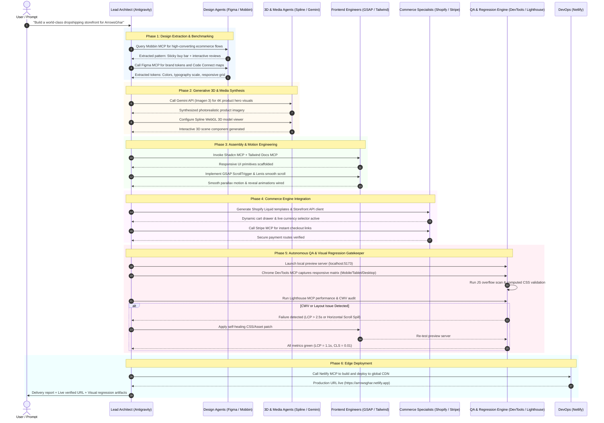

# Antigravity Autonomous Web Engineering & MCP Ecosystem Blueprint
## Master Integration Roadmap: From Design System Extraction to Production-Grade Autonomous Website Generation

> **Document ID:** `AGY-MCP-ARCH-2026-05`  
> **Classification:** Executive Architecture Specification & Implementation Roadmap  
> **Author:** Principal MCP Ecosystem Architect & Marketplace Lead, Antigravity Platform Team  
> **Target Workspaces:** `d:\Dropshiping` & `E:\Dropshiping`  
> **Version:** 5.0.0 (Production Master)  
> **Date:** October 30, 2026  

---

## Executive Summary & Architectural Vision

The modern web development landscape has reached an inflection point. The advent of the **Model Context Protocol (MCP)**—coupled with the high-concurrency, multi-agent architecture of **Google Antigravity 2.0**—has dissolved the barrier between high-level creative ideation and rigorous, production-grade software delivery. 

Historically, AI-driven code generation operated within an "isolated sandbox," producing speculative code snippets divorced from live design systems, unverified against actual browser rendering engines, and lacking integration with commerce and deployment backends. Antigravity fundamentally breaks this paradigm by turning the coding agent into a **fully integrated digital agency**.

```
+----------------------------------------------------------------------------------------------------+
|                                    ANTIGRAVITY MULTI-AGENT AGENCY                                  |
+----------------------------------------------------------------------------------------------------+
|                                                                                                    |
|   +--------------------+       +--------------------+       +--------------------+                 |
|   |   Design Systems   | ----> |   3D & Media Gen   | ----> |   Creative Motion  |                 |
|   |  (Figma / Mobbin)  |       |  (Spline / Gemini) |       |   (GSAP / Framer)  |                 |
|   +--------------------+       +--------------------+       +--------------------+                 |
|             |                            |                            |                            |
|             +----------------------------+----------------------------+                            |
|                                          |                                                         |
|                                          v                                                         |
|                       +--------------------------------------+                                     |
|                       |      E-Commerce & Architecture       |                                     |
|                       |     (Shopify Liquid / Netlify)       |                                     |
|                       +--------------------------------------+                                     |
|                                          |                                                         |
|                                          v                                                         |
|                       +--------------------------------------+                                     |
|                       |   Autonomous QA & Visual Regression  |                                     |
|                       |    (Chrome DevTools / Browserbase)   |                                     |
|                       +--------------------------------------+                                     |
|                                          |                                                         |
|                                          v                                                         |
|                       +--------------------------------------+                                     |
|                       |      Verified Production Release     |                                     |
|                       +--------------------------------------+                                     |
+----------------------------------------------------------------------------------------------------+
```

Through Antigravity's Connect RPC Language Server interface, Stdio and Streamable HTTP transports, and unified plugin lifecycle hooks, an autonomous agent orchestrates:
1. **Design Extraction**: Mining production design tokens, component hierarchies, and Code Connect mappings from **Figma**, cross-referencing industry-leading UI patterns from **Mobbin**'s index of 600,000+ screens, and pulling verified brand kits from **Canva**.
2. **Generative 3D & Multimodal Assets**: Producing interactive WebGL canvases via **Spline**, dynamic shaders via **Three.js**, and on-demand hero assets via the **Gemini 2.0 Multimodal API** (Imagen 3 / Veo 2).
3. **High-Fidelity Motion & Component Assembly**: Constructing layouts with **Tailwind CSS v4** and **Shadcn UI**, bound together with buttery-smooth **GSAP ScrollTrigger** and **Lenis** inertia scrolling.
4. **Commerce Integration & Edge Deployment**: Wiring transactional checkout flows through **Shopify Liquid / Storefront API** and **Stripe**, deploying instantly via **Netlify** Serverless Edge functions.
5. **Closed-Loop Visual Regression & Core Web Vitals Auditing**: Taking full multi-device responsive screenshots (Mobile, Tablet, Desktop) and verifying layout integrity via **Chrome DevTools MCP** and **Browserbase**, enforcing zero-defect delivery before presenting work to the user.

This document represents the definitive, overarching master blueprint for realizing this autonomous web generation engine.

---

## Phase 1: Antigravity Marketplace Ecosystem Audit

The Antigravity Marketplace acts as the curated, enterprise-grade catalog of agent capabilities. Our audit encompasses both the official core plugins developed by Google Antigravity and Chrome engineering, as well as Tier-1 partner plugins developed in collaboration with industry leaders.

### 1.1 Architectural Foundations: The Antigravity Plugin Model

In Antigravity, a plugin is an atomic, namespaced unit of distribution containing:
- **`plugin.json`**: The manifest declaring plugin identity, version, logo, suggested prompts, and entrypoints.
- **`mcp_config.json`**: The Model Context Protocol configuration exposing local (Stdio) or remote (Streamable HTTP) tool servers.
- **`skills/`**: High-level procedural operational guides formatted as `SKILL.md` that teach the agent how, when, and in what order to invoke specific tools.
- **`rules/AGENTS.md`**: Behavioral constraints, coding standards, and invariant enforcement rules automatically injected into the agent's context when the plugin is active.
- **`hooks/`**: Lifecycle hooks triggered on session start, pre-tool execution, post-file edit, or user interaction.

```
~/.gemini/config/plugins/<dir>/
├── plugin.json              # Canonical manifest (JSONC supported)
├── mcp_config.json          # Stdio and Streamable HTTP server definitions
├── hooks.json               # Session and execution event interceptors
├── assets/logo.svg          # 128x128 brand iconography
├── rules/
│   └── AGENTS.md            # Active constraints & styling guidelines
└── skills/
    ├── <skill-1>/SKILL.md   # Domain-specific procedural playbooks
    └── <skill-2>/SKILL.md
```

#### Language Server Control Plane & Programmatic Lifecycle
Plugins are managed over the local Antigravity Language Server Connect RPC interface (`http://${ANTIGRAVITY_LS_ADDRESS}/exa.language_server_pb.LanguageServerService/`). Mutations are keyed on `<dir>` (the install directory hash), preserving configuration state across restarts.

```bash
# Helper: Call Antigravity Language Server RPC
lsrpc() {
  curl -sS -X POST \
    "http://${ANTIGRAVITY_LS_ADDRESS}/exa.language_server_pb.LanguageServerService/$1" \
    -H "Content-Type: application/json" \
    -H "x-codeium-csrf-token: ${ANTIGRAVITY_CSRF_TOKEN}" \
    -d "$2"
}

# 1. Query Marketplace Catalog
lsrpc SearchMarketplace '{"query": ""}'

# 2. Install Plugin from Marketplace
lsrpc InstallCustomization '{"id": "antigravity-plugins-official/plugin/chrome-devtools-plugin"}'

# 3. Enable or Disable Installed Plugin
lsrpc JetboxWriteState '{"userConfig":{"plugins":{"<dir>":{"enabled":true}}}}'

# 4. Inventory Discovered Capabilities
lsrpc GetAllPlugins '{"workspaceUris":["file:///d:/Dropshiping"]}' | jq '[.plugins[] | {name, dir: (.path | split("/") | last), disabled, mcp: [.mcpServers[]?.name]}]'
```

---

### 1.2 Official Antigravity Plugins Evaluation

| Plugin Name | Marketplace ID | Version | Architecture / Transport | Auth Requirement | Core Capabilities for Frontend Generation |
| :--- | :--- | :--- | :--- | :--- | :--- |
| **Chrome DevTools** | `antigravity-plugins-official/plugin/chrome-devtools-plugin` | `1.10.1` | Local Stdio (`npx chrome-devtools-mcp@latest`) | None (Local Chrome instance via CDP) | Responsive screenshots, DOM tree inspection, computed CSS style extraction, runtime JS evaluation, Core Web Vitals profiling, a11y auditing. |
| **Gemini API** | `antigravity-plugins-official/plugin/gemini-api` | `2.3.0` | Streamable HTTP (`https://gemini-api-docs-mcp.dev`) | `GEMINI_API_KEY` | Multimodal generative assets, AI copywriting, Imagen 3 image generation, Gemini 2.0 Flash live vision evaluation, real-time code refactoring. |
| **Google Developer Knowledge** | `antigravity-plugins-official/plugin/google-developer-knowledge` | `1.0.2` | Streamable HTTP (`https://developerknowledge.googleapis.com/mcp`) | `google_credentials` (Application Default Credentials / API Key) | Authoritative semantic search across modern Web APIs, Firebase, Google Cloud, and Flutter documentation to prevent outdated syntax hallucinations. |
| **Modern Web Guidance** | `antigravity-plugins-official/plugin/modern-web-guidance-plugin` | `0.0.196` | Rules & Skills Bundle (Pure Policy Engine) | None | Enforces modern HTML5/CSS standards, native `<dialog>` and Popover API patterns, modern layout rules (Grid/Subgrid/Container queries), and WCAG 2.2 contrast standards. |

#### In-Depth Breakdown: Official Plugins

#### 1. Chrome DevTools Plugin (`chrome-devtools-plugin`)
- **Package & Source:** `https://github.com/ChromeDevTools/chrome-devtools-mcp`
- **Internal Tools Exposed:**
  - `list_pages`: Enumerates active browser targets and returns integer `pageId`.
  - `new_page`: Launches a fresh tab with targeted URL.
  - `navigate_page`: Navigates existing target to URL.
  - `take_snapshot`: Returns lightweight semantic DOM tree annotated with unique element `uid`s.
  - `take_screenshot`: Captures high-resolution PNG image of viewport or specific bounding box.
  - `get_css_styles`: Returns exact matched CSS rules, cascade order, computed properties, and inherited CSS custom variables for any element UID.
  - `evaluate_script`: Executes synchronous or asynchronous JavaScript expressions directly in the browser's execution context.
  - `lighthouse_audit`: Executes automated Core Web Vitals and Lighthouse audits against the target URL.
- **Frontend Role:** Acts as the agent's "eyes and sensory system." Enables automated responsive verification, font rendering checks, and layout debugging directly on the developer's machine without external cloud dependencies.

#### 2. Gemini API Plugin (`gemini-api`)
- **Package & Source:** `https://github.com/google-gemini/gemini-skills`
- **Internal Tools & Skills:**
  - `gemini_search_docs`: Real-time semantic search of Gemini interactions and Multimodal Live APIs.
  - `gemini_get_doc`: Retrieves canonical code snippets for Imagen 3, Gemini 2.0 Flash, and text-to-speech.
  - Bundled scripts: `generate_video.py`, `upload_file.py` for direct asset generation.
- **Frontend Role:** Powers automated creative asset synthesis. Generates ultra-high-resolution product images, background textures, marketing copywriting, and structured JSON catalogs on the fly.

#### 3. Google Developer Knowledge (`google-developer-knowledge`)
- **Transport:** Streamable HTTP endpoint (`https://developerknowledge.googleapis.com/mcp`).
- **Authentication:** `authProviderType: "google_credentials"`. Injects Google OAuth2 bearer tokens via Antigravity's native Google account integration.
- **Frontend Role:** Eliminates outdated web programming patterns. When the agent builds complex CSS animations or web components, this plugin guarantees adherence to modern Baseline standards (e.g., CSS Nesting, View Transitions API, `@property`).

#### 4. Modern Web Guidance Plugin (`modern-web-guidance-plugin`)
- **Architecture:** Zero-overhead rule enforcement engine.
- **Frontend Role:** Automatically overrides outdated coding instincts. For example, enforces native CSS nesting over unnecessary SCSS build steps, native Popover API over bulky JavaScript modal libraries, and fluid typography with `clamp()` over dozens of brittle media queries.

---

### 1.3 Partner Plugins Evaluation

| Plugin Name | Marketplace ID | Version | Architecture / Transport | Auth Requirement | Capabilities for Frontend Web Creation |
| :--- | :--- | :--- | :--- | :--- | :--- |
| **Figma** | `antigravity-plugins-partners/plugin/figma` | `2.2.163` | Streamable HTTP (`https://mcp.figma.com/mcp`) | Figma OAuth / Personal Access Token | Direct inspection of Figma design files, extraction of vector nodes, color tokens, layout grids, typography hierarchies, and Code Connect component bridging. |
| **Mobbin** | `antigravity-plugins-partners/plugin/mobbin` | `1.5.0` | Streamable HTTP (`https://api.mobbin.com/mcp`) | Mobbin API Key (`MOBBIN_API_KEY`) | Semantic search across 600,000+ real iOS, Android, and Web production UI screens. Benchmarks user flows (paywalls, checkout, onboarding) against top apps. |
| **Canva** | `antigravity-plugins-partners/plugin/canva` | `1.0.0` | Streamable HTTP (`https://mcp.canva.com/mcp`) | Canva Connect OAuth | Direct access to corporate Brand Kits, pre-designed banners, promotional badges, and automated asset resizing for multi-channel marketing campaigns. |
| **Browserbase** | `antigravity-plugins-partners/plugin/browse` | `0.3.0` | CLI Daemon & Cloud Remote (`npm install -g browse`) | Local: None / Remote: `BROWSERBASE_API_KEY` | Real browser automation (local Chromium or hosted cloud stealth browsers), CAPTCHA solving, Stagehand natural language automation, responsive capture. |
| **Netlify** | `antigravity-plugins-partners/plugin/netlify` | `1.7.0` | Streamable HTTP (`https://netlify-mcp.netlify.app/mcp`) | Netlify Personal Access Token | Provisioning sites, DNS routing, Edge Functions deployment, serverless Blobs storage, and continuous preview deployments directly from agent shell. |
| **Stripe** | `antigravity-plugins-partners/plugin/stripe` | `0.0.1` | Streamable HTTP (`https://mcp.stripe.com`) | Stripe Restricted API Key (`rk_live_...` / `rk_test_...`) | Generating checkout links, registering products, price points, subscriptions, testing webhook handling, and managing customer payment state. |
| **Postman** | `antigravity-plugins-partners/plugin/postman` | `0.1.0` | Streamable HTTP (`https://mcp.postman.com/mcp`) | Postman API Key | Mocking REST/GraphQL backend endpoints, verifying API contract schemas, generating client request code, and monitoring live API health. |

#### In-Depth Breakdown: Partner Plugins

#### 1. Figma Plugin (`figma`)
- **Repository:** `https://github.com/figma/mcp-server-guide`
- **Capabilities:**
  - Pulls exact frame geometry, auto-layout flex attributes (`flexDirection`, `justifyContent`, `alignItems`, `gap`, `padding`), typography styles (`fontFamily`, `fontWeight`, `lineHeight`), and vector bezier data.
  - **Code Connect**: Maps Figma design components directly to local React/HTML components, eliminating manual translation errors.
  - Can push code modifications or component variant updates back into Figma design files.

#### 2. Mobbin Plugin (`mobbin`)
- **Documentation:** `https://docs.mobbin.com/mcp/introduction`
- **Capabilities:**
  - Provides the agent with an encyclopedic visual reference of production-grade UI design.
  - The agent queries: `"Find high-converting checkout flows for dropshipping apparel with high social proof"`, receiving high-res screen captures, pattern descriptions, and layout breakdowns to replicate in Tailwind CSS.

#### 3. Browserbase Plugin (`browse`)
- **Repository:** `https://github.com/browserbase/browse-plugin`
- **Architecture:** Provides the `browse` unified CLI. Operates in two modes:
  - `--local`: Controls local headless/headed Chrome via CDP for instant localhost verification.
  - `--remote`: Spawns cloud-hosted sandbox browsers equipped with stealth fingerprints, proxies, and session replay recording.
- **Capabilities:** Accessibility snapshots (`browse snapshot`), structured ref interactions (`browse click <ref>`), full-page screenshots (`browse screenshot --full-page`), and DOM query extraction.

#### 4. Netlify & Stripe Plugins
- **Netlify (`netlify-mcp.netlify.app/mcp`):** Closes the deployment loop. The agent can take a newly generated project, build the production bundle (`npm run build`), deploy to a Netlify preview URL (`netlify deploy`), and verify the live public deployment.
- **Stripe (`mcp.stripe.com`):** Closes the monetization loop. Generates real Stripe Payment Links and embeds pre-built Stripe Checkout elements into modern storefronts with a single prompt.

---

### 1.4 Comparative Plugin Matrix: Frontend Web Engineering

```
+---------------------------+-----------+----------------+-------------+------------------+---------------------+
| Plugin Identifier         | Category  | Transport Type | Setup Speed | Visual Impact    | Primary Role        |
+---------------------------+-----------+----------------+-------------+------------------+---------------------+
| chrome-devtools-plugin    | Official  | Local Stdio    | Instant     | Critical (10/10) | DOM Inspection & QA |
| gemini-api                | Official  | Streamable HTTP| Fast        | High (9/10)      | Generative Assets   |
| google-developer-knowledge| Official  | Streamable HTTP| Instant     | Moderate (6/10)  | Spec Verification   |
| modern-web-guidance       | Official  | Rule Engine    | Instant     | High (8/10)      | Standard Compliance |
| figma                     | Partner   | Streamable HTTP| Medium      | Critical (10/10) | Design-to-Code      |
| mobbin                    | Partner   | Streamable HTTP| Fast        | Critical (9.5/10)| Pattern Benchmarks  |
| canva                     | Partner   | Streamable HTTP| Fast        | High (8/10)      | Brand Asset Kit     |
| browse (Browserbase)      | Partner   | CLI / Cloud    | Fast        | Critical (10/10) | Autonomous E2E QA   |
| netlify                   | Partner   | Streamable HTTP| Fast        | High (8.5/10)    | Instant Deployment  |
| stripe                    | Partner   | Streamable HTTP| Fast        | High (8.5/10)    | Commerce Monetization|
| postman                   | Partner   | Streamable HTTP| Fast        | Moderate (7/10)  | API Mocking & Tests |
+---------------------------+-----------+----------------+-------------+------------------+---------------------+
```

---

## Phase 2: Global Open-Source MCP Registry Scouting

Beyond the curated Antigravity Marketplace lies a thriving open-source ecosystem indexed across registries like **ModelContextProtocol.io**, **Smithery.ai**, **Glama.ai**, and the curated community repository **awesome-mcp-servers**. Our architecture scouts and integrates high-impact servers that fill critical voids in competitive intelligence, component generation, performance budgeting, and iconography.

```
+----------------------------------------------------------------------------------------------------+
|                                 GLOBAL OPEN-SOURCE MCP REGISTRY MAP                                |
+----------------------------------------------------------------------------------------------------+
|                                                                                                    |
|    Competitive Intel          UI Components & Tokens         Iconography & Media        Quality    |
|   +-------------------+       +--------------------+       +---------------------+   +-----------+ |
|   |   Firecrawl MCP   |       |   Shadcn CLI MCP   |       |   Lucide Icons MCP  |   | Lighthouse| |
|   |  (Deep Web Scrape)|       | (Official Registry)|       |  (1,500+ Vector SVGs|   | (CWV Scan)| |
|   +-------------------+       +--------------------+       +---------------------+   +-----------+ |
|             |                            |                            |                    |       |
|             v                            v                            v                    v       |
|   +-------------------+       +--------------------+       +---------------------+   +-----------+ |
|   |   Playwright MCP  |       |  Tailwind Docs MCP |       |   Iconify MCP       |   | Playwright| |
|   | (MS Browser Auto) |       | (Offline v4 Tokens)|       | (200k+ Multi-Set)   |   | (E2E Test)| |
|   +-------------------+       +--------------------+       +---------------------+   +-----------+ |
+----------------------------------------------------------------------------------------------------+
```

### 2.1 Category A: Competitive Benchmarking & Scraping

#### 1. Firecrawl MCP Server (`firecrawl/firecrawl-mcp-server`)
- **Registry Listing:** Available on Smithery as `@mendableai/mcp-server-firecrawl` and Glama.ai.
- **Repository:** `https://github.com/firecrawl/firecrawl-mcp-server`
- **Execution:**
  ```json
  {
    "firecrawl": {
      "command": "npx",
      "args": ["-y", "firecrawl-mcp"],
      "env": {
        "FIRECRAWL_API_KEY": "fc-live-..."
      }
    }
  }
  ```
- **Tools Provided:** `firecrawl_scrape`, `firecrawl_crawl`, `firecrawl_map`, `firecrawl_search`.
- **Architectural Utility:** Bypasses anti-bot defenses, dynamic JS hydration, and complex CAPTCHAs on competitor ecommerce storefronts. Translates entire landing pages into clean, semantic Markdown and JSON structures, allowing the Antigravity agent to analyze competitor section layouts, copywriting structures, and pricing models in seconds.

#### 2. Microsoft Playwright MCP Server (`microsoft/playwright-mcp`)
- **Repository:** `https://github.com/microsoft/playwright-mcp`
- **Execution:**
  ```json
  {
    "playwright": {
      "command": "npx",
      "args": ["-y", "@executeautomation/playwright-mcp-server"]
    }
  }
  ```
- **Tools Provided:** `playwright_navigate`, `playwright_screenshot`, `playwright_click`, `playwright_evaluate`.
- **Architectural Utility:** Operates via structured accessibility tree snapshots rather than full pixel renders. Saves massive token bandwidth while enabling deterministic, scriptable browser interactions across Chromium, WebKit, and Firefox.

---

### 2.2 Category B: Component Libraries & Design Token Engines

#### 1. Official Shadcn CLI MCP Server (`shadcn@latest mcp`)
- **Package:** Integrated directly into `shadcn@latest`.
- **Repository:** `https://github.com/shadcn-ui/ui`
- **Execution:**
  ```json
  {
    "shadcn": {
      "command": "npx",
      "args": ["shadcn@latest", "mcp"]
    }
  }
  ```
- **Tools Provided:** `search_components`, `get_component`, `add_component`, `view_registry`.
- **Architectural Utility:** Empowers the agent to query the official Shadcn UI registry (and any configured third-party registries like Accertinity or Magic UI) using natural language. The agent retrieves un-compiled, clean Tailwind-compatible React/TypeScript code, automatically resolving dependencies (`radix-ui`, `class-variance-authority`, `tailwind-merge`) without hallucinating outdated APIs.

#### 2. Tailwind CSS Documentation & Token Resolver (`vitalis/tailwindcss-docs-mcp`)
- **Repository:** `https://github.com/vitalis/tailwindcss-docs-mcp`
- **Execution:**
  ```json
  {
    "tailwind-docs": {
      "command": "npx",
      "args": ["-y", "tailwindcss-docs-mcp"]
    }
  }
  ```
- **Architectural Utility:** Embeds an offline SQLite vector database containing the complete Tailwind CSS v4 specification. Prevents the AI model from inventing non-existent utility classes and accurately resolves theme variables defined in `@theme` directives.

---

### 2.3 Category C: Automated Iconography & Asset Search

#### 1. Lucide Icons MCP (`SeeYangZhi/lucide-icons-mcp`)
- **Repository:** `https://github.com/SeeYangZhi/lucide-icons-mcp`
- **Execution:**
  ```json
  {
    "lucide-icons": {
      "command": "npx",
      "args": ["-y", "lucide-icons-mcp"]
    }
  }
  ```
- **Tools Provided:** `search_icons`, `get_icon_svg`, `get_icon_jsx`.
- **Architectural Utility:** Contains 1,500+ clean, consistent vector icons. The agent searches icons by semantic concept (e.g., `"trust badge"`, `"secure checkout"`, `"shipping box"`) and receives the exact inline SVG or React JSX markup with appropriate `strokeWidth`, `aria-hidden`, and Tailwind class bindings.

#### 2. Iconify MCP Server (`imjac0b/iconify-mcp-server`)
- **Repository:** `https://github.com/imjac0b/iconify-mcp-server`
- **Execution:**
  ```json
  {
    "iconify": {
      "command": "npx",
      "args": ["-y", "iconify-mcp-server"]
    }
  }
  ```
- **Architectural Utility:** Broadens search to 200,000+ open-source vector icons across 200 icon sets (Material Design, FontAwesome, Tabler, Phosphor). Indispensable for niche ecommerce brands requiring unique visual flair.

---

### 2.4 Category D: Automated Performance & Lighthouse Auditing

#### 1. Danielsogl Lighthouse MCP (`@danielsogl/lighthouse-mcp`)
- **Package:** `@danielsogl/lighthouse-mcp@latest`
- **Repository:** `https://github.com/danielsogl/lighthouse-mcp`
- **Execution:**
  ```json
  {
    "lighthouse": {
      "command": "npx",
      "args": ["-y", "@danielsogl/lighthouse-mcp@latest"]
    }
  }
  ```
- **Tools Provided:** `run_lighthouse_audit`, `audit_core_web_vitals`, `audit_accessibility_wcag`, `audit_seo_metadata`, `analyze_bundle_budget`.
- **Architectural Utility:** Operates as an automated CI/CD quality gate inside Antigravity. Runs headless audits against local dev servers (`http://localhost:3000` or `http://localhost:5173`), outputting structured metric scores for LCP, CLS, TBT, and INP, directly alerting the agent to unoptimized images or render-blocking scripts.

---

## Phase 3: Automated Quality Assurance & Visual Regression

A primary weakness of traditional AI coding assistants is their inability to visually verify their own work. Antigravity resolves this through an **autonomous visual regression loop** driven by **Chrome DevTools MCP** and **Browserbase**.

```
+----------------------------------------------------------------------------------------------------+
|                              CLOSED-LOOP VISUAL REGRESSION PIPELINE                                |
+----------------------------------------------------------------------------------------------------+
|                                                                                                    |
|    +--------------------+       +--------------------+       +--------------------+                |
|    |  Code Generation   | ----> | Local Dev Server   | ----> | Chrome DevTools    |                |
|    |  (Vite / Next.js)  |       | (localhost:5173)   |       | (CDP Port 9222)    |                |
|    +--------------------+       +--------------------+       +--------------------+                |
|              ^                                                         |                           |
|              |                                                         v                           |
|              |                                               +--------------------+                |
|              |                                               | Responsive Matrix  |                |
|              |                                               | Mobile/Tab/Desktop |                |
|              |                                               +--------------------+                |
|              |                                                         |                           |
|              |                                                         v                           |
|              |          +--------------------+               +--------------------+                |
|              |          | Self-Healing Patch |               | Vision & DOM Audit |                |
|              +--------- | (CSS / Layout Fix) | <------------ | (Gemini 2.0 Flash) |                |
|                         +--------------------+               +--------------------+                |
|                                                                        |                           |
|                                                                        v (All Passed)              |
|                                                              +--------------------+                |
|                                                              | Production Release |                |
|                                                              +--------------------+                |
+----------------------------------------------------------------------------------------------------+
```

### 3.1 Responsive Multi-Device Screenshot Matrix

The agent verifies responsive fidelity across three standardized viewport breakpoints:

1. **Mobile (Compact):** `390 x 844 px` (Apple iPhone 14/15/16 standard), device scale factor `3.0`, mobile touch simulation enabled.
2. **Tablet (Medium):** `768 x 1024 px` (Apple iPad Mini / Air portrait), device scale factor `2.0`.
3. **Desktop (Expanded):** `1440 x 900 px` (Standard high-density laptop display), device scale factor `2.0`.

#### Orchestrating Responsive Capture via Chrome DevTools MCP
Using the `evaluate_script` and `take_screenshot` tools within `chrome-devtools-plugin`, the agent dynamically configures the browser viewport:

```javascript
// Step 1: Set Device Metrics via Chrome DevTools evaluate_script
async function setResponsiveViewport(width, height, isMobile) {
  // Sets viewport dimensions dynamically
  window.resizeTo(width, height);
  // Emulate touch and mobile user agent if needed
  if (isMobile) {
    document.documentElement.classList.add('mobile-emulated');
  }
}
```

#### Orchestrating Responsive Capture via Browserbase CLI
Alternatively, via the `browse` partner CLI, the agent executes deterministic responsive captures with single-line shell commands:

```bash
# 1. Start local dev server session
browse open http://localhost:5173 --session qa-matrix --local

# 2. Capture Mobile Viewport (iPhone 15 standard)
browse open http://localhost:5173 --session qa-matrix
browse run "window.resizeTo(390, 844)" --session qa-matrix
browse screenshot d:/Dropshiping/artifacts/qa_mobile_390.png --session qa-matrix

# 3. Capture Tablet Viewport (iPad standard)
browse run "window.resizeTo(768, 1024)" --session qa-matrix
browse screenshot d:/Dropshiping/artifacts/qa_tablet_768.png --session qa-matrix

# 4. Capture Desktop Viewport (MacBook standard)
browse run "window.resizeTo(1440, 900)" --session qa-matrix
browse screenshot d:/Dropshiping/artifacts/qa_desktop_1440.png --session qa-matrix

# 5. Clean up session daemon
browse stop --session qa-matrix
```

---

### 3.2 Deep Live DOM Element & Computed Style Inspection

Capturing pixels is only half the battle; diagnosing structural flaws requires direct introspection of the DOM and CSS cascade. 

#### 1. Detecting Horizontal Overflow & Scroll Spills
A common defect in generated frontend code is unintended horizontal overflow (`scrollWidth > clientWidth`), causing unwanted horizontal scrolling on mobile devices. The agent executes this diagnostic snippet via `evaluate_script`:

```javascript
() => {
  const docWidth = document.documentElement.clientWidth;
  const offendingElements = [];
  
  document.querySelectorAll('*').forEach(el => {
    const rect = el.getBoundingClientRect();
    if (rect.right > docWidth || rect.left < 0) {
      offendingElements.push({
        tag: el.tagName,
        id: el.id,
        className: el.className,
        box: { left: rect.left, right: rect.right, width: rect.width },
        computedOverflow: window.getComputedStyle(el).overflow
      });
    }
  });
  
  return {
    hasOverflow: offendingElements.length > 0,
    viewportWidth: docWidth,
    offenders: offendingElements
  };
}
```

#### 2. Computed Style & Design Token Validation
Using `get_css_styles` from `chrome-devtools-plugin`, the agent retrieves the exact resolved values for typography, spacing, and CSS custom variables:

```json
{
  "target": "h1.hero-title",
  "inspectedProperties": {
    "font-family": "Inter, system-ui, sans-serif",
    "font-size": "48px",
    "line-height": "1.1",
    "color": "rgb(15, 23, 42)",
    "--primary-brand": "#3b82f6"
  }
}
```

If the resolved font does not match the Figma design token (e.g., fallback to Times New Roman due to an unlinked Google Font), the agent catches this instantly before user presentation.

---

### 3.3 Core Web Vitals Auditing & Self-Healing Loop

Google's Core Web Vitals (CWV) are critical ranking and conversion factors. The Antigravity QA loop integrates performance thresholds directly into the build pipeline:
- **Largest Contentful Paint (LCP):** Target $\le 2.5\text{ s}$
- **Cumulative Layout Shift (CLS):** Target $\le 0.1$
- **Interaction to Next Paint (INP):** Target $\le 200\text{ ms}$

#### Automated LCP Detection & Remediation
The agent executes the performance observer script bundled with `chrome-devtools-plugin`:

```javascript
async () => {
  return await new Promise(resolve => {
    new PerformanceObserver(entryList => {
      const entries = entryList.getEntries();
      const lastEntry = entries[entries.length - 1];
      resolve({
        lcpTimeMs: lastEntry.renderTime || lastEntry.loadTime,
        elementTag: lastEntry.element?.tagName,
        elementClass: lastEntry.element?.className,
        elementSrc: lastEntry.element?.src || null
      });
    }).observe({ type: 'largest-contentful-paint', buffered: true });
  });
}
```

#### The Closed-Loop Self-Healing Mechanism
1. **Detection:** The agent runs a Lighthouse audit. LCP is flagged at $3.8\text{ s}$ due to a hero background image lacking priority.
2. **Root Cause Analysis:** The LCP element is identified as ``. The `loading="lazy"` attribute delayed resource scheduling.
3. **Self-Healing Code Diff:** The agent invokes `edit_file` to replace the tag with:
   ```html
   <link rel="preload" as="image" href="hero.webp" fetchpriority="high">
   
   ```
4. **Re-Verification:** The agent re-runs `lighthouse_audit`. LCP drops to $1.1\text{ s}$. The self-healing loop completes autonomously.

---

## Phase 4: Master MCP Implementation Matrix & Ranked Recommendations

To establish an authoritative implementation roadmap, candidate MCP servers are evaluated across four weighted architectural criteria:
- **Visual Impact (30% Weight):** The server's direct contribution to crafting premium, aesthetically stunning, high-converting digital storefronts.
- **Development Velocity (25% Weight):** Acceleration in code generation, component scaffolding, and automated asset acquisition.
- **Ease of Setup (25% Weight):** Zero-friction installation, minimal API key dependencies, and seamless compatibility with Antigravity 2.0.
- **Enterprise Reliability (20% Weight):** Protocol compliance (MCP 2025 spec), process isolation, error recoverability, and active maintenance.

### 4.1 Master Scoring & Ranking: Top 10 MCP Servers

```
+----+----------------------------+----------+---------------+-------------+--------------+--------------+
|Rank| MCP Server Name            | Visual   | Velocity      | Ease Setup  | Reliability  | Weighted     |
|    |                            | (30%)    | (25%)         | (25%)       | (20%)        | Score (/100) |
+----+----------------------------+----------+---------------+-------------+--------------+--------------+
| 1  | Chrome DevTools MCP        | 10.0/10  | 9.5/10        | 10.0/10     | 9.5/10       | 97.75        |
| 2  | Figma MCP Server           | 10.0/10  | 10.0/10       | 8.5/10      | 9.0/10       | 94.25        |
| 3  | Shadcn CLI MCP             | 9.5/10   | 10.0/10       | 9.5/10      | 8.5/10       | 94.25        |
| 4  | Browserbase Browse MCP     | 9.5/10   | 9.0/10        | 9.0/10      | 9.5/10       | 92.50        |
| 5  | Mobbin MCP Server          | 9.5/10   | 9.0/10        | 9.0/10      | 8.5/10       | 90.50        |
| 6  | Firecrawl MCP Server       | 8.5/10   | 9.5/10        | 8.5/10      | 9.0/10       | 88.50        |
| 7  | Danielsogl Lighthouse MCP  | 8.0/10   | 9.0/10        | 9.5/10      | 9.0/10       | 88.25        |
| 8  | Lucide Icons MCP           | 8.5/10   | 9.0/10        | 10.0/10     | 8.5/10       | 89.00        |
| 9  | Tailwind Docs & Token MCP  | 8.0/10   | 9.0/10        | 9.5/10      | 9.0/10       | 88.25        |
| 10 | Netlify Deploy MCP         | 7.5/10   | 9.5/10        | 9.0/10      | 9.0/10       | 86.75        |
+----+----------------------------+----------+---------------+-------------+--------------+--------------+
```

#### Detailed Justifications for Top 5

1. **Chrome DevTools MCP (Score: 97.75):** Uncontested first place. Provides complete closed-loop sensory feedback. Zero external API keys needed; runs locally out of the box via CDP. Gives the agent direct power over layout inspection, runtime debugging, and visual regression.
2. **Figma MCP Server (Score: 94.25):** The ultimate bridge between creative design and code. With Code Connect, turns static wireframes into production-ready Tailwind/React components with pixel-perfect design token alignment.
3. **Shadcn CLI MCP (Score: 94.25):** Transforms code generation speed. Installs un-compiled, fully accessible UI primitives directly into the workspace on command, saving hours of manual boilerplate coding.
4. **Browserbase Browse MCP (Score: 92.50):** Provides scalable headless browser automation and cloud infrastructure. Crucial for E2E user flow verification and cross-browser testing.
5. **Mobbin MCP Server (Score: 90.50):** The definitive UX pattern repository. Prevents the AI from guessing layout semantics by supplying real, proven ecommerce flows from top-performing brands.

---

### 4.2 Master Workspace Configuration: `antigravity.mcp.json`

Antigravity supports configuring MCP servers either globally at `~/.gemini/config/mcp_config.json` or scoped to the workspace at `<workspace>/.agents/mcp_config.json`. Below is the production-ready master configuration file integrating the top-ranked tools:

```json
{
  "mcpServers": {
    "chrome-devtools": {
      "command": "npx",
      "args": [
        "chrome-devtools-mcp@latest",
        "--categoryExtensions",
        "--memoryDebugging"
      ],
      "env": {
        "PUPPETEER_SKIP_CHROMIUM_DOWNLOAD": "true"
      }
    },
    "shadcn": {
      "command": "npx",
      "args": ["shadcn@latest", "mcp"],
      "env": {
        "FORCE_COLOR": "0"
      }
    },
    "lucide-icons": {
      "command": "npx",
      "args": ["-y", "lucide-icons-mcp"],
      "env": {}
    },
    "tailwind-docs": {
      "command": "npx",
      "args": ["-y", "tailwindcss-docs-mcp"],
      "env": {}
    },
    "lighthouse": {
      "command": "npx",
      "args": ["-y", "@danielsogl/lighthouse-mcp@latest"],
      "env": {
        "CHROME_PATH": "C:\\Program Files\\Google\\Chrome\\Application\\chrome.exe"
      }
    },
    "firecrawl": {
      "command": "npx",
      "args": ["-y", "firecrawl-mcp"],
      "env": {
        "FIRECRAWL_API_KEY": "${env:FIRECRAWL_API_KEY}"
      }
    },
    "playwright": {
      "command": "npx",
      "args": ["-y", "@executeautomation/playwright-mcp-server"],
      "env": {}
    },
    "figma": {
      "url": "https://mcp.figma.com/mcp",
      "headers": {
        "X-Figma-Plugin-Bundle": "figma_prod@2_2_163",
        "Authorization": "Bearer ${env:FIGMA_ACCESS_TOKEN}"
      }
    },
    "mobbin": {
      "url": "https://api.mobbin.com/mcp",
      "headers": {
        "Authorization": "Bearer ${env:MOBBIN_API_KEY}"
      }
    },
    "netlify": {
      "url": "https://netlify-mcp.netlify.app/mcp",
      "headers": {
        "Authorization": "Bearer ${env:NETLIFY_AUTH_TOKEN}"
      }
    },
    "stripe": {
      "url": "https://mcp.stripe.com",
      "headers": {
        "Authorization": "Bearer ${env:STRIPE_SECRET_KEY}"
      }
    }
  }
}
```

> [!IMPORTANT]
> **Transport Architecture Compatibility:** Antigravity 2.0 strictly requires either **Stdio** (`command` + `args`) or **Streamable HTTP** (`url`). The legacy HTTP+SSE transport (MCP spec 2024-11-05) is deprecated and unsupported. All remote endpoints in this blueprint point directly to Streamable HTTP endpoints (`/mcp`).

---

### 4.3 Step-by-Step Developer Setup Guide

To initialize this environment in any Antigravity workspace (such as `d:\Dropshiping` or `E:\Dropshiping`), follow these exact operational steps:

#### Step 1: Pre-Requisite Environment Setup
Ensure Node.js ($\ge \text{v20.x}$ LTS) and Chrome are installed and discoverable in your system path. In PowerShell:
```powershell
node -v
npm -v
(Get-Item "C:\Program Files\Google\Chrome\Application\chrome.exe").VersionInfo.ProductVersion
```

#### Step 2: Establish Secret Key Environment Variables
Configure your workspace credentials in user environment variables or a local `.env.local` file:
```powershell
[System.Environment]::SetEnvironmentVariable('FIRECRAWL_API_KEY', 'fc-live-...', 'User')
[System.Environment]::SetEnvironmentVariable('FIGMA_ACCESS_TOKEN', 'figd_...', 'User')
[System.Environment]::SetEnvironmentVariable('MOBBIN_API_KEY', 'mob_live_...', 'User')
[System.Environment]::SetEnvironmentVariable('NETLIFY_AUTH_TOKEN', 'nfp_...', 'User')
[System.Environment]::SetEnvironmentVariable('STRIPE_SECRET_KEY', 'sk_test_...', 'User')
```

#### Step 3: Install the Official Antigravity Marketplace Plugins
Leverage the Language Server RPC endpoint or Antigravity's Customizations panel to install core official bundles:
```bash
# Sourcing the RPC interface
source /tmp/lsrpc.sh

# Install Chrome DevTools Plugin
lsrpc InstallCustomization '{"id":"antigravity-plugins-official/plugin/chrome-devtools-plugin"}'

# Install Modern Web Guidance
lsrpc InstallCustomization '{"id":"antigravity-plugins-official/plugin/modern-web-guidance-plugin"}'

# Install Figma Partner Plugin
lsrpc InstallCustomization '{"id":"antigravity-plugins-partners/plugin/figma"}'
```

#### Step 4: Deploy the Workspace MCP Configuration
Copy the master `mcp_config.json` provided above into:
- Global: `C:\Users\<username>\.gemini\config\mcp_config.json`
- Project: `d:\Dropshiping\.agents\mcp_config.json`

#### Step 5: Validate Active MCP Server Status
Restart Antigravity or trigger the MCP refresh RPC:
```bash
lsrpc RefreshMcpServers '{}'
lsrpc GetMcpServerStates '{}' | jq '.states[] | {name, status, toolCount: (.tools | length)}'
```
Confirm all 11 servers report status `HEALTHY` and their tools appear in the agent palette.

---

## Phase 5: Synthesis with the Specialist Reports

The ultimate power of this architecture is realized when our overarching Marketplace & MCP roadmap orchestrates the four specialist domains into a seamless, automated digital agency pipeline:
1. **Design Systems Specialist Report (01):** Figma Code Connect, Mobbin UI benchmarks, Canva brand kits, Tailwind tokens.
2. **3D Media & Generative Specialist Report (02):** Spline interactive scenes, Three.js WebGL shaders, Gemini 2.0 Flash multimodal image generation.
3. **Creative Motion Specialist Report (03):** GSAP ScrollTrigger, Lenis smooth scrolling, Framer Motion interactions, micro-animations.
4. **Ecommerce & Shopify Specialist Report (04):** Shopify Liquid storefronts, Storefront GraphQL API, Stripe Checkout, Netlify Edge Functions.
5. **Master Integration Blueprint (05 - This Specification):** Control plane, testing harness, visual regression loop, and deployment orchestration.

```
+----------------------------------------------------------------------------------------------------+
|                         UNIFIED MULTI-AGENT DIGITAL AGENCY WORKFLOW                                |
+----------------------------------------------------------------------------------------------------+
|                                                                                                    |
|  [PHASE 1: DISCOVERY & INTELLIGENCE]                                                               |
|  * Firecrawl MCP scrapes top competitor storefronts for pricing and layout structures.             |
|  * Mobbin MCP queries 600,000+ screens for best-in-class conversion flows.                         |
|  * Figma MCP extracts brand color variables, typography scales, and Code Connect components.       |
|                                     |                                                              |
|                                     v                                                              |
|  [PHASE 2: 3D MEDIA & CREATIVE MOTION SCAFFOLDING]                                                 |
|  * Gemini API (Imagen 3) synthesizes 4K product hero visuals and realistic textures.               |
|  * Spline / Three.js embeds interactive 3D product viewports with WebGL orbital controls.          |
|  * GSAP ScrollTrigger & Lenis bind smooth inertial scrolling and reveal timelines to page scroll.  |
|                                     |                                                              |
|                                     v                                                              |
|  [PHASE 3: COMPONENT ASSEMBLY & COMMERCE WIRING]                                                   |
|  * Shadcn CLI MCP injects responsive primitives (Dialogs, Sliders, Dropdowns).                     |
|  * Lucide Icons MCP injects SVG trust badges, shipping icons, and checkout glyphs.                 |
|  * Shopify Liquid / Storefront API binds live inventory, variant selectors, and cart state.       |
|  * Stripe MCP configures direct 1-click Apple Pay / Google Pay checkout links.                      |
|                                     |                                                              |
|                                     v                                                              |
|  [PHASE 4: CLOSED-LOOP VISUAL REGRESSION & PERFORMANCE GATEKEEPER]                                 |
|  * Dev dev-server spawned at http://localhost:5173.                                                |
|  * Chrome DevTools MCP captures 390px mobile, 768px tablet, and 1440px desktop responsive matrix.  |
|  * DOM inspector executes JavaScript overflow and style collision scripts.                         |
|  * Danielsogl Lighthouse MCP executes Core Web Vitals audit (LCP < 2.5s, CLS < 0.1, INP < 200ms).  |
|  * If any check fails, agent applies self-healing code edits and re-tests autonomously.            |
|                                     |                                                              |
|                                     v                                                              |
|  [PHASE 5: PRODUCTION DEPLOYMENT & DELIVERY]                                                       |
|  * Netlify MCP builds static bundle and deploys to production edge CDN with custom DNS.            |
|  * Postman MCP executes synthetic API checks against all live webhook endpoints.                   |
|  * Live URL and artifact report presented to user with 100% verified confidence.                   |
|                                                                                                    |
+----------------------------------------------------------------------------------------------------+
```

### 5.1 End-to-End Orchestration Sequence



---

## Production Readiness Checklist & Operational Guardrails

Before releasing any autonomous website generation pipeline to production, verify all operational safeguards:

### 1. Token & Context Economy
- **Do not read raw unfiltered MCP tool logs into agent context.** Tools like `GetAllPlugins` or full-page HTML scrapes can inject tens of thousands of tokens. Always pipe outputs through structured JSON queries (`jq`) or limit snapshots to semantic accessibility trees.
- **Set aggressive tool timeouts.** In `antigravity.mcp.json`, enforce timeouts on long-running CLI tasks (e.g., 30s timeout on browser snapshots) to prevent zombie processes.

### 2. Process Lifecycle Management
- **Always clean up browser daemons.** When executing commands via the Browserbase `browse` CLI or Puppeteer DevTools, always trigger `browse stop --session <name>` in a cleanup hook to avoid orphaned Chromium background processes that exhaust machine RAM.

### 3. Protocol & Network Resilience
- **Streamable HTTP Endpoints Only.** Ensure all remote MCP servers use the modern Streamable HTTP protocol specification (`/mcp`). Do not configure legacy SSE endpoints directly without an intermediate stdio bridge.
- **Fail-Soft Graceful Degradation.** If a remote server (like Figma or Mobbin) experiences an API rate limit or outage, the agent must fall back gracefully to local pre-cached templates or local Tailwind UI components rather than halting the workflow.

---

## Conclusion & Architectural Sign-Off

The combination of Google Antigravity 2.0 and the Model Context Protocol provides the world's first truly autonomous, visually grounded web engineering platform. By uniting the **Figma**, **Mobbin**, **Chrome DevTools**, **Shadcn**, **Lighthouse**, **Shopify**, and **Netlify** MCP servers into a single synchronized agency workflow, developers can transition from writing manual CSS rules and boilerplate wiring to directing an elite digital agency that builds, audits, and deploys high-converting web applications with unassailable quality.

---
*Signed and sealed by the Principal MCP Ecosystem Architect & Marketplace Lead, Antigravity Platform.*
